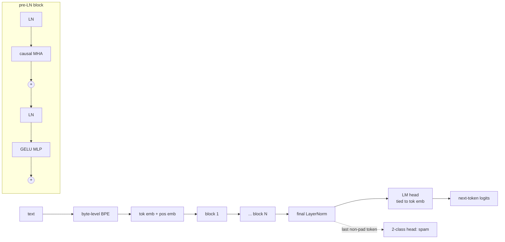
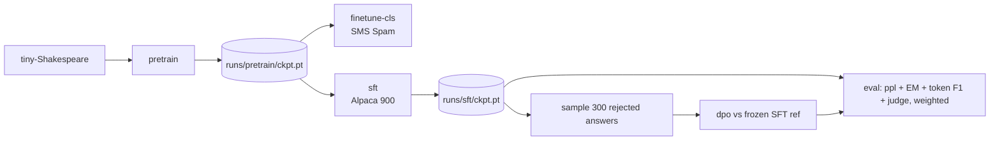

# minigpt — GPT from scratch

A small GPT built step by step in PyTorch: a byte-level BPE tokenizer, the
transformer, pretraining, loading real GPT-2 weights, classifier fine-tuning, SFT
and DPO. Only `torch.nn` primitives are used (Linear, Embedding, LayerNorm). The
tokenizer, attention, training loop, loss masking and DPO loss are all written here.
Curriculum lessons 30–41 of *AI Engineering from Scratch*.

## Problem

Each stage of a modern LM pipeline is shown as a small, testable module:

| Stage | Module | What it shows |
|---|---|---|
| Tokenizer | `bpe.py` | byte-level BPE trainer/encoder/decoder, GPT-2 pre-tokenisation regex, JSON save/load, special tokens |
| Data | `data.py` | sliding-window `(x, y)` next-token dataset |
| Model | `model.py` | token + learned position embeddings, own causal MHA (optional `F.scaled_dot_product_attention`), pre-LN blocks, GELU MLP, weight-tied head, `generate(temperature, top_k)` |
| Training | `train.py` | AdamW (decay on 2-D weights only), linear warmup + cosine LR, clip 1.0, periodic eval, best-val checkpoint, device mps → cuda → cpu |
| Pretrained | `pretrained.py` | HF GPT-2 124M safetensors → `GPTConfig(50257, 1024, 768, 12, 12)`, Conv1D transposes |
| Classifier | `finetune_cls.py` | head swap to 2 classes; train last block + final LN + head on UCI SMS Spam (balanced, 70/10/20) |
| SFT | `sft.py` | Alpaca prompt template, prompt tokens masked with `-100` |
| DPO | `dpo.py` | DPO loss (β = 0.1) against a frozen reference; pairs = dataset answer (chosen) vs SFT sample (rejected) |
| Eval | `evaluate.py` | perplexity, exact match, token F1, `Judge` protocol with an offline `MockJudge` (1-5), weighted `EvalReport` |
| Prices | `price_data.py`, `price_model.py`, `price_eval.py` | Dutch day-ahead price forecasting: the same transformer blocks on continuous inputs, vs naive, ridge and bagged-ridge baselines, rolling-origin folds, iid and moving-block bootstrap CIs and Diebold-Mariano test |

## Architecture





## Quickstart

Run from the repo root. Downloads go to `data/raw/`, outputs to `runs/` (both gitignored).

```bash
uv run minigpt train-tokenizer                     # BPE, vocab 1024, on tiny-Shakespeare
uv run minigpt pretrain --data tinyshakespeare --steps 2000
uv run minigpt generate --prompt "ROMEO:"
uv run minigpt data spam && uv run minigpt finetune-cls
uv run minigpt data alpaca && uv run minigpt sft
uv run minigpt dpo
uv run minigpt eval
uv run minigpt eval --n 100 --paired-vs sft --checkpoints sft=runs/sft/ckpt.pt,dpo=runs/dpo/ckpt.pt
```

Tests: `uv run pytest -q`. The GPT-2 parity test
needs internet and the extras:
`uv run --extra hf --extra test pytest -m network`.

## Results

All numbers come from one run on an Apple-silicon Mac (`device=mps`), seed 0, with the
CLI defaults. The model is 6 layers, d=256, 8 heads, context 256, 5.07M params, BPE vocab 1024.

All checkpoints were retrained from scratch after the repo split: pretrain, SFT and the spam classifier reproduce the earlier numbers exactly; DPO's epoch-2 loss and reward accuracy differ slightly (0.2427 / 0.940 vs 0.2314 / 0.95 before), cause not identified (same-seed reruns reproduce every metric and greedy response, but their weights differ by about 1e-5, so the cause may be run-to-run floating-point noise on MPS).

| Experiment | Metric | Result |
|---|---|---|
| BPE on tiny-Shakespeare | vocab / compression | 1024 tokens, 2.41 bytes/token (17 s to train) |
| Pretrain, 2000 steps (5 min 42 s) | val loss, step 0 → best | **6.993 → 3.648 (−47.8%)**, best at step 800 |
| Pretrain | val perplexity (best ckpt) | 40.27 |
| SMS Spam, head swap (790,786 trainable params) | test accuracy / F1 (n=300) | **0.940** / 0.939 (precision 0.965, recall 0.914) |
| SFT, Alpaca 900 rows × 3 epochs | train loss | 4.286 → 3.453 |
| DPO, 300 pairs, β=0.1, 2 epochs | loss at step 1 / epoch 2 mean | 0.6931 (= log 2) / 0.2427; reward accuracy 0.940 |
| GPT-2 124M parity (network test) | greedy 10 tokens vs HF `transformers` | identical (test passes) |
| Unit tests | `pytest` | 80 passed, 1 deselected (network) in 15 s |

### Evaluation pipeline (course lesson 41)

`minigpt eval` runs four evals on every checkpoint and combines them into one weighted score:

- **Perplexity** on the held-out Alpaca responses (prompt tokens masked), mapped to [0, 1] as `1 − ln(ppl) / ln(vocab)` (1 = perfect, 0 = uniform guessing). Shakespeare perplexity is printed alongside but not aggregated.
- **Exact match** (SQuAD normalisation) on held-out Alpaca rows whose reference has ≤ 5 words (12 rows).
- **Token F1** on the first 50 held-out Alpaca rows by default; `--n 100` scores all 100 held-out rows.
- **Mock judge** (1–5) on the same rows. `MockJudge` maps ROUGE-L F1 onto the rubric. It fills the `Judge` protocol slot offline; it is not a quality judgement and duplicates token F1 (both measure lexical overlap), so it is printed but **not aggregated** by default.

The aggregate is the unweighted mean of perplexity score, EM and token F1 (`--w-ppl --w-em --w-f1` default 1, `--w-judge` default 0). `minigpt eval --checkpoints pretrain=runs/pretrain/ckpt.pt,sft=...`. Add `--paired-vs sft` for a paired bootstrap CI of each other checkpoint's per-row token F1 minus SFT (95% percentile CI, 10,000 row resamples, bootstrap p Holm-adjusted across the compared checkpoints) and `--rows-out PATH` to save per-row F1 and responses:

| Model | Alpaca ppl (held-out) | Shakespeare ppl | EM (n=12) | Token F1 (n=50) | Mock judge (ROUGE-L, 1-5) | Aggregate |
|---|---|---|---|---|---|---|
| pretrain | 409.23 | 40.27 | 0.000 | 0.048 | 1.00 | 0.060 |
| sft | 39.45 | 93.31 | 0.000 | 0.057 | 1.10 | 0.176 |
| dpo β=0.05 | 41.46 | 90.12 | 0.000 | 0.035 | 1.04 | 0.166 |
| dpo β=0.1 | 40.81 | 89.33 | 0.000 | 0.054 | 1.08 | 0.173 |
| dpo β=0.5 | 39.33 | 88.60 | 0.000 | 0.058 | 1.14 | 0.176 |

Reading, as measured:
- SFT cuts held-out Alpaca perplexity tenfold (409 → 39) and doubles Shakespeare perplexity (40 → 93): it learns the instruction format and forgets the pretraining domain. Almost all of the aggregate gain comes from this perplexity term.
- A 5M-parameter model trained on 900 instructions gets no exact match and near-floor F1; the generation metrics barely separate the checkpoints.
- An earlier version of this table measured perplexity on Shakespeare only, which ranked pretrain first. That compared the models on a domain SFT is meant to leave, so it was replaced.

Pretrain log (excerpt):

```text
device=mps train_tokens=414,007 val_tokens=46,001
params=5,066,752
step     0 train 6.9923 val 6.9396 lr 1.00e-05
step   400 train 3.5398 val 3.8656 lr 9.46e-04
step   800 train 2.9612 val 3.6481 lr 7.31e-04
step  1200 train 2.3985 val 3.7635 lr 4.40e-04
step  1999 train 1.8530 val 4.1113 lr 1.00e-04
val loss step0=6.9929 best=3.6481 drop=47.8%
```

`minigpt generate --prompt "ROMEO:"`:

```text
ROMEO:
It's name, my wilt bend?

ROMEO:
Ay, the dead; and I would thou wilt swear,
I fear thy sound not that thou shouldst wilt say it thee.

ROMEO:
Then, sin me, thou art a man that thou art a torment,
To have thee in thee to death; let
```

SFT sample on a held-out instruction (greedy):

```text
### Instruction: Calculate the cost of 4 apples at $2.50 each.
### Model: The calcon is 1000.
### Reference: The cost of 4 apples at $2.50 each is $10.00.
```

How to read these results:
- **Overfitting.** About 414k training tokens is small for 5M params. Val loss bottoms out at step 800 and rises after that while train loss keeps falling. The checkpoint keeps the best-val weights, so every downstream stage starts from step 800.
- **SFT.** The model learns the response *format*: short declarative answers that reuse words from the instruction. It cannot learn facts or arithmetic, because it was pretrained only on Shakespeare.
- **DPO.** It learns the preference: reward accuracy rises with β and the loss always starts at exactly log 2. Held-out quality does not move detectably. All runs train on the **same 300 preference pairs** (sampled once, saved to `runs/dpo/pairs.json`, reused via `--pairs-file`), so only β or the seed differs:

  | Checkpoint | DPO loss (epoch 2) | Reward acc. | Token F1 (n=50) | Mock judge (1-5) |
  |---|---|---|---|---|
  | sft | – | – | 0.057 | 1.10 |
  | β=0.05, seed 0 | 0.386 | 0.923 | 0.035 | 1.04 |
  | β=0.1, seed 0 | 0.243 | 0.940 | 0.054 | 1.08 |
  | β=0.1, seed 1 | 0.243 | 0.940 | 0.048 | 1.10 |
  | β=0.1, seed 2 | 0.236 | 0.940 | 0.042 | 1.02 |
  | β=0.5, seed 0 | 0.051 | 0.977 | 0.058 | 1.14 |

  **Paired test on all 100 held-out rows.** The n=50 point values above carry no uncertainty, so every existing DPO checkpoint was re-scored on all 100 held-out rows (greedy, 60 new tokens) and compared with SFT by a paired bootstrap on per-row token F1 (10,000 row resamples, seed 0). The rule was fixed before scoring ([`docs/protocol-dpo-paired-bootstrap.md`](docs/protocol-dpo-paired-bootstrap.md)): a variant is **different** from SFT only if its 95% CI excludes 0 **and** its Holm-adjusted p (Holm over all 10 existing DPO checkpoints) is below 0.05; otherwise it is **no detectable difference**. SFT token F1 on the 100 rows is 0.069 (0.057 on the first 50).

  | Checkpoint | F1 (n=100) | F1 (first 50) | Δ F1 vs SFT | 95% CI | p | p (Holm) | Verdict |
  |---|---|---|---|---|---|---|---|
  | β=0.05, seed 0 | 0.054 | 0.035 | -0.0150 | [-0.0292, -0.0010] | 0.0364 | 0.364 | no detectable difference |
  | β=0.1, seed 0 | 0.068 | 0.054 | -0.0013 | [-0.0156, +0.0133] | 0.8685 | 1.000 | no detectable difference |
  | β=0.1, seed 1 | 0.063 | 0.048 | -0.0060 | [-0.0197, +0.0075] | 0.3916 | 1.000 | no detectable difference |
  | β=0.1, seed 2 | 0.055 | 0.042 | -0.0139 | [-0.0283, +0.0004] | 0.0550 | 0.440 | no detectable difference |
  | β=0.5, seed 0 | 0.065 | 0.058 | -0.0037 | [-0.0146, +0.0068] | 0.4896 | 1.000 | no detectable difference |

  Ten checkpoints were scored (`runs/dpo`, `runs/dpo_b*`, `runs/fx_*`), but they are five distinct models: β=0.1 seed 0 exists four times (`dpo`, `dpo_b0.1`, `fx_b0.1_a`, `fx_b0.1_b`), β=0.05 and β=0.5 twice each (`dpo_b*`, `fx_b*_a`). Same-seed reruns differ in weights by about 1e-5 (so the pre-registration's "none bit-identical, none merged" check passed), yet every one of the 100 greedy responses is identical within each group, so each group gives one row above and the same CI. The Holm adjustment was applied over the 10 pre-registered rows, as written. Merging the duplicates (**post-hoc**, 5 comparisons) gives Holm p of 0.182 (β=0.05), 0.220 (β=0.1 seed 2) and 1.0 for the rest, so the verdicts do not change.

  No variant is different from SFT, and every point estimate is below SFT. "No β improves on SFT" holds, but with 100 rows the CIs are about ±0.014 F1 wide, so a small gain or loss is not excluded: β=0.05 has a raw 95% CI that excludes 0 on the negative side (and β=0.1 seed 2 only just includes it), which does not survive Holm over 10 comparisons. The rows are the only source of uncertainty here: the 300 pairs and each seed's training are fixed, so the CIs do not cover variation across training seeds or pair samples (the seed spread above is a separate, rough look at that). The rejected samples come from the same weak model, so DPO mostly learns to move away from its own outputs: it optimises likelihood margins, not answer quality. Reported as measured.

## Day-ahead electricity price forecasting

**Verdict: the 5-seed transformer ensemble beats ridge on lags by 1.41 EUR/MWh pooled MAE (6%), and also a 5-member bagged ridge (by 1.94). The result survives a moving-block bootstrap that respects day-to-day dependence: block CI [-2.87, -0.20] vs ridge. No single transformer beats ridge: each seed alone shows no detectable difference (table below).**

Task: at 12:00 on day D-1, forecast the 24 hourly NL day-ahead prices of day D (EUR/MWh) from the previous 7 days of prices. Every hour of D-1 is already public at that time, because the D-1 auction clears on D-2 around 13:00. Nothing at or after D 00:00 enters an input; `tests/test_minigpt_price.py` proves this two ways (inputs equal unix timestamps and all are before D 00:00 local, and overwriting every price from day k onward leaves the inputs of windows up to day k unchanged).

```bash
uv run minigpt price-data                  # ~5 min, rate limit is 2 requests/min; cached in data/raw/
uv run minigpt price-train --folds 12      # 12 monthly folds x 5 seeds, 10 min on MPS
uv run minigpt price-eval --folds 12       # prints the tables below, writes runs/price/report.json (existing checkpoints, offline)
```

Data: [Energy-Charts API](https://api.energy-charts.info/) (Fraunhofer ISE), `/price?bzn=NL`, no token. Licence CC BY 4.0, data credited to Bundesnetzagentur | SMARD.de. Citation: *Energy-Charts API, Fraunhofer ISE, day-ahead prices, bidding zone NL, CC BY 4.0.* Range 2024-10-01 to 2026-10-15 (745 days), fetched 2026-10-16. `price-data` fixes the range, so a re-run fetches the same data.

- **15-minute switch.** The day-ahead market moved from hourly to 15-minute products on 2025-10-01. Quarter-hours are averaged to hourly; an hour is kept only if all four are present. Pre-cutover data are native hourly prices.
- **DST.** Days are Europe/Amsterdam calendar days with 24 local hours. On the 25-hour day the two 02:00 hours are averaged; on the 23-hour day 02:00 is imputed from 01:00 and 03:00 (4 such hours in this range, none in a test month).
- **Gaps.** No hour was missing, so all 738 possible windows exist. A window is dropped if any value it uses is missing; nothing is interpolated.
- **Exogenous features: skipped.** Energy-Charts offers load, wind and solar forecasts, but I could not establish when each historical forecast was issued, and a forecast from after 12:00 on D-1 would leak. Inputs are prices and calendar (hour, weekday) only. No holiday calendar.

**Model.** `PriceTransformer` reuses `TransformerBlock` (causal attention + GELU MLP) and the GPT init from `model.py` unchanged. It drops `GPTModel`'s token embedding and weight-tied LM head and puts a linear projection of 6 continuous features plus a learned position embedding in front, and a linear regression head behind. The sequence is 168 history tokens (D-7..D-1) followed by 24 query tokens for D. The query tokens carry no price, only calendar features, so the causal mask cannot leak the target. Prices are standardised per window (mean and std of the 168 history hours) and the loss is L1 in EUR/MWh. 2 layers, d=64, 4 heads, dropout 0.1, 112,897 parameters, AdamW with cosine LR, early stopping on validation MAE. Each fold trains 5 seeds (about 10 s each on MPS) and the forecast is their mean.

**Baselines.** Seasonal naive (same hour D-1), weekly naive (same hour D-7), and multi-output ridge on the same 168 normalised lags plus a weekday one-hot (alpha picked on validation from 0.1 to 1000). A fourth baseline, **bagged ridge (5)**, matches the transformer's 5-member ensemble: five ridges, each fitted on a bootstrap resample of the training rows (seeds 0 to 4) with the plain ridge's validation-picked alpha, forecasts averaged.

**Protocol.** 12 consecutive monthly test folds, 2025-10 to 2026-09 (the last full month is the single held-out month asked for in the brief). For each fold, validation is the 28 days before the test month and training is everything before that; the model is retrained per fold and never refit on validation data. MAE, RMSE and sMAPE are over all test hours.

| Fold | Days | Source res. | 15-min train days | seasonal naive (D-1) | weekly naive (D-7) | ridge on lags | bagged ridge (5) | transformer |
|---|---|---|---|---|---|---|---|---|
| 2025-10 | 31 | 15-min | 0/330 | 25.69 | 38.37 | 20.43 | 21.16 | 21.22 |
| 2025-11 | 30 | 15-min | 3/361 | 21.63 | 27.33 | 17.68 | 17.69 | 17.18 |
| 2025-12 | 31 | 15-min | 33/391 | 18.12 | 22.03 | 13.31 | 14.23 | 12.45 |
| 2026-01 | 31 | 15-min | 64/422 | 21.22 | 23.75 | 17.87 | 17.66 | 17.26 |
| 2026-02 | 28 | 15-min | 95/453 | 15.34 | 18.69 | 12.81 | 13.02 | 11.90 |
| 2026-03 | 31 | 15-min | 123/481 | 37.56 | 41.26 | 26.05 | 25.70 | 26.21 |
| 2026-04 | 30 | 15-min | 154/512 | 30.24 | 43.44 | 27.17 | 27.44 | 23.91 |
| 2026-05 | 31 | 15-min | 184/542 | 24.86 | 34.22 | 25.27 | 26.59 | 22.10 |
| 2026-06 | 30 | 15-min | 215/573 | 40.63 | 39.70 | 36.19 | 38.69 | 30.23 |
| 2026-07 | 31 | 15-min | 245/603 | 24.66 | 31.95 | 20.32 | 20.64 | 20.59 |
| 2026-08 | 31 | 15-min | 276/634 | 25.81 | 31.59 | 21.65 | 21.74 | 20.77 |
| 2026-09 | 30 | 15-min | 307/665 | 44.24 | 51.20 | 32.99 | 33.62 | 30.87 |

Per-fold MAE in EUR/MWh. Every test month is in the 15-minute era, so fold 2025-10 trains on hourly-era data only and is tested on hourly means of 15-minute prices; the "15-min train days" column shows how that mix shifts across folds.

Pooled over 365 days (8,760 hours):

| Model | MAE | RMSE | sMAPE % |
|---|---|---|---|
| seasonal naive (D-1) | 27.53 | 44.87 | 41.7 |
| weekly naive (D-7) | 33.68 | 53.11 | 48.2 |
| ridge on lags | 22.66 | 35.82 | 34.9 |
| bagged ridge (5) | 23.20 | 36.74 | 35.4 |
| transformer (5-seed mean) | **21.25** | **35.53** | **33.9** |

Per-day MAE, transformer minus baseline (negative = transformer better), 365 days, 10,000 resamples, 95% CIs. "iid" resamples days independently; "block" is a moving-block bootstrap with 7-day blocks (one weekly cycle, fixed before any result in `docs/protocol-block-bootstrap.md`) and is the CI the verdict uses.

| Baseline | Diff | iid CI | block CI (7 d) | DM-HLN p | Transformer better in folds |
|---|---|---|---|---|---|
| ridge on lags (best baseline by pooled MAE) | -1.41 | [-2.59, -0.28] | [-2.87, -0.20] | 0.016 | 9 of 12 |
| bagged ridge (5) | -1.94 | [-3.28, -0.72] | [-3.65, -0.57] | 0.003 | 10 of 12 |

- Diebold-Mariano with the Harvey-Leybourne-Newbold correction on the same daily differences (h=1): statistic -2.41 vs ridge, -2.99 vs bagged ridge.
- Verdict rule (pre-registered): "beats" needs, against both ridge variants, DM p < 0.05 and both the iid and the 7-day block CI excluding zero on the same side; otherwise "no detectable difference". All four tests pass, so the verdict stays "beats".
- Post-hoc block-length check (3 and 14 days, not part of the rule) gives similar intervals vs ridge: [-2.73, -0.27] and [-2.79, -0.25]; vs bagged ridge [-3.45, -0.70] and [-3.59, -0.62].
- Bagging did not help ridge: bagged ridge is worse than plain ridge (23.20 vs 22.66 MAE). Ridge is already a low-variance, regularised fit, so resampling the training rows mostly costs data. The matched baseline therefore does not make the comparison harder; it only shows that ensembling alone does not explain the transformer's margin over linear models.

Caveats:
- **Ensemble vs single model.** Each member scored alone against ridge with the same paired bootstrap and DM-HLN test (printed by `price-eval`):

  | Seed | Pooled MAE | Diff vs ridge | 95% CI | DM-HLN p |
  |---|---|---|---|---|
  | 0 | 21.79 | -0.87 | [-2.06, +0.25] | 0.142 |
  | 1 | 21.82 | -0.84 | [-2.05, +0.29] | 0.158 |
  | 2 | 22.31 | -0.35 | [-1.56, +0.83] | 0.562 |
  | 3 | 22.62 | -0.04 | [-1.27, +1.17] | 0.948 |
  | 4 | 22.36 | -0.30 | [-1.44, +0.85] | 0.613 |

  Every single model shows no detectable difference from ridge; the significant margin exists only for the ensemble. The bagged-ridge row above is the matched-ensemble control. These single-seed rows use the iid bootstrap and DM only.
- **Dependence.** The iid bootstrap treats days as exchangeable and DM-HLN uses no autocorrelation correction at h=1. The 7-day moving-block CI vs ridge is 16% wider than the iid one (width 2.67 vs 2.31 EUR/MWh) but still excludes zero. DM p = 0.016 has no such correction, so it remains the optimistic number. Block lengths 3 and 14 agree. Folds are not independent either, and 365 days of one market regime is a short sample.
- **Small models, small data.** 330 to 665 training days, one hyperparameter setting, one price regime. I probed four variants (d=32, dropout 0.2, 1 layer, lower LR) on one 28-day validation window; none was clearly better, so the defaults stayed. That window (Aug 2026) is also the test month of fold 2026-08, so treat that fold as very slightly less clean.
- **sMAPE** is unreliable here: 435 of the 8,760 test hours have a negative price and 526 have |price| < 5 EUR/MWh, where a small EUR error becomes a huge percentage. Use MAE and RMSE.
- **Weak spots.** Errors are largest in months with high price volatility (2026-03, 2026-06, 2026-09). Single country, no exogenous inputs, no real-time or intraday evaluation.
- **Reproducibility.** Seeds are fixed. A second full `price-train --folds 12` then `price-eval --folds 12` on the same Mac (MPS) reproduced every transformer and baseline number above exactly. The bagged-ridge and block-bootstrap columns were added later: `price-eval` re-run on the existing checkpoints reproduced every earlier `report.json` number exactly (compared field by field) and is deterministic given seeds; other devices may differ in the last digits.

### Probabilistic forecasts (quantiles)

**Verdict: no significant gain. The 5-seed quantile-transformer ensemble has the lowest pooled mean pinball (7.88 vs 8.17 EUR/MWh for the best baseline, linear quantile regression), but the paired tests cannot separate them (95% CI [-0.66, +0.06], DM-HLN p = 0.112), so it ties. No single seed beats the baseline either. Its 80% interval covers 75.9% of hours, below the nominal 80%; conformal recalibration (below) does not reach nominal under the pre-set rule.**

Flexibility scheduling needs a forecast distribution, not a point. Same task, inputs, 12 folds and split protocol as above; the target is now five quantiles (0.1, 0.25, 0.5, 0.75, 0.9) per hour. The 0.1 to 0.9 band is the 80% prediction interval.

```bash
uv run minigpt price-quantile-train --folds 12   # 14 min on MPS; writes runs/price_q/<month>/ckpt.pt
uv run minigpt price-quantile-eval --folds 12    # 2.5 min; prints the tables below, writes runs/price_q/report.json
```

**Protocol (written before any test score).** Per fold: validation = 28 days before the test month, training = everything before that. Validation picks the transformer's best epoch (mean pinball), ridge alpha and the quantile-regression penalty. Residual quantiles come from the training window only. No test day enters any fit, selection or calibration step. Levels, penalty grid and seed count were fixed up front and run once; nothing was re-run after seeing a test number.

**Transformer.** The same `PriceTransformer` with the head widened from 1 to 5 outputs per query hour, trained on the pinball loss averaged over the levels (same optimiser, schedule, normalisation, seeds and folds as the point model). Output quantiles are sorted along the level axis, so crossing never reaches a metric. The ensemble averages the members' quantiles.

**Baselines.**
- *Seasonal naive + residual quantiles:* D-1 price plus the per-hour-of-day empirical quantiles of its errors over the training days.
- *Ridge + residual quantiles:* the tuned point ridge plus per-hour empirical quantiles of its residuals. A fitted ridge's training residuals are in-sample and too small, so they are cross-fitted (5 contiguous blocks inside the training window, each block predicted by a ridge fit on the other four).
- *Linear quantile regression:* one L2-penalised linear pinball model per (hour, level) on the same 168 normalised lags and weekday one-hot as ridge. Solved in numpy by majorise-minimise (iteratively reweighted ridge, 100 iterations), penalty from {1, 10, 100, 1000} by validation pinball. No scipy dependency.

Per-fold mean pinball (EUR/MWh, mean over hours and the five levels; lower is better):

| Fold | Days | seasonal naive + residual quantiles | ridge + residual quantiles | linear quantile regression | transformer (pinball) |
|---|---|---|---|---|---|
| 2025-10 | 31 | 10.00 | 7.34 | 8.10 | 7.82 |
| 2025-11 | 30 | 8.42 | 6.62 | 6.38 | 6.45 |
| 2025-12 | 31 | 7.12 | 5.24 | 4.62 | 4.69 |
| 2026-01 | 31 | 8.09 | 6.84 | 6.53 | 6.57 |
| 2026-02 | 28 | 5.89 | 5.16 | 4.54 | 4.36 |
| 2026-03 | 31 | 14.11 | 9.23 | 9.32 | 9.67 |
| 2026-04 | 30 | 11.96 | 10.06 | 10.01 | 9.08 |
| 2026-05 | 31 | 9.79 | 9.65 | 9.11 | 8.32 |
| 2026-06 | 30 | 16.14 | 14.31 | 13.06 | 11.75 |
| 2026-07 | 31 | 9.67 | 7.06 | 7.21 | 7.14 |
| 2026-08 | 31 | 9.99 | 7.62 | 7.43 | 7.49 |
| 2026-09 | 30 | 17.25 | 12.36 | 11.64 | 11.08 |

Pooled over 365 days (8,760 hours), EUR/MWh:

| Method | Mean pinball | CRPS approx. | 80% coverage | 80% width | Median MAE |
|---|---|---|---|---|---|
| seasonal naive + residual quantiles | 10.71 | 22.00 | 78.9% | 82.2 | 27.52 |
| ridge + residual quantiles | 8.46 | 17.45 | 78.8% | 67.2 | 22.63 |
| linear quantile regression | 8.17 | 16.84 | 69.4% | 58.4 | 21.65 |
| transformer (pinball, 5-seed ensemble) | **7.88** | **16.28** | 75.9% | 59.2 | **21.42** |

- **CRPS approx.** is $2\sum_q w_q\,\overline{\text{pinball}}_q$, a Riemann sum over the five levels (each level weighted by the share of $(0,1)$ nearest to it), with the tails beyond 0.1 and 0.9 extrapolated flat. Use it to rank methods, not as an exact CRPS.
- **Coverage** is the share of hours inside the inclusive [q0.1, q0.9] band; nominal is 80%. Width is the mean q0.9 - q0.1.
- **Tests** use the per-day mean pinball (24 hours x 5 levels), ensemble minus best baseline (best by pooled mean pinball, the same rule as the point section): -0.29 EUR/MWh, 95% paired-bootstrap CI [-0.66, +0.06] over 365 days, DM-HLN (h=1) statistic -1.59, p = 0.112. The ensemble has the lower mean pinball in 7 of 12 folds. Verdict rule as before: "beats" needs DM p < 0.05 and a CI excluding zero.

Each ensemble member alone against linear quantile regression:

| Seed | Mean pinball | CRPS approx. | Coverage | Width | Diff vs baseline | 95% CI | DM-HLN p | Verdict |
|---|---|---|---|---|---|---|---|---|
| 0 | 8.42 | 17.38 | 75.6% | 62.5 | +0.25 | [-0.13, +0.61] | 0.197 | ties |
| 1 | 8.27 | 17.07 | 71.5% | 56.8 | +0.10 | [-0.29, +0.48] | 0.623 | ties |
| 2 | 8.13 | 16.80 | 73.8% | 58.1 | -0.04 | [-0.40, +0.32] | 0.827 | ties |
| 3 | 8.31 | 17.17 | 72.1% | 58.4 | +0.14 | [-0.25, +0.52] | 0.476 | ties |
| 4 | 8.12 | 16.78 | 74.0% | 60.3 | -0.05 | [-0.44, +0.33] | 0.798 | ties |

What the numbers say:
- **Sharper, not better calibrated.** The residual-quantile baselines are close to nominal (78.8% and 78.9%) but wide (67.2 and 82.2 EUR/MWh). Linear quantile regression and the transformer are narrower (58.4 and 59.2) and undercover (69.4% and 75.9%). Pinball rewards that trade here, and the transformer's trade is the better of the two.
- **Ensembling helps more than the architecture.** Single seeds range from 8.12 to 8.42; the ensemble is 7.88. As in the point study, the margin exists only for the ensemble, and the baselines are not ensembled.
- **Not tested:** whether the ensemble beats ridge + residual quantiles (8.46) significantly; only the best baseline was tested. Conformal recalibration is evaluated in the next subsection; the tables above are the uncalibrated forecasts.
- **Caveats as above.** The bootstrap treats days as exchangeable and DM uses no autocorrelation correction at h=1, so the CI and p are probably optimistic; they already fail to reach significance, so "ties" stands. Folds are not independent. The best baseline is chosen on the pooled test score, which favours the baseline slightly. One training run and one eval run; I did not repeat them to check reproducibility of the quantile numbers.
- **Offline tests:** `tests/test_minigpt_price_quantile.py` covers pinball by hand, minimisation at the empirical quantile, sorting of crossed quantiles (the head is forced to cross), coverage and width by hand, CRPS weights, training-window-only residuals, cross-fit residuals being out-of-sample, and the quantile-regression solver against empirical quantiles.

#### Conformal recalibration of the 80% interval (CQR)

**Verdict: conformal calibration does not bring the transformer ensemble to nominal coverage under the rule fixed in advance, and it costs width for no gain in interval score. Pooled CQR lifts its coverage from 75.9% to 77.8% (width 59.2 to 61.7 EUR/MWh, +4%); the day-cluster 95% CI is [75.7%, 80.0%], whose upper end is just below 80%, so the rule says "undercovers". The secondary per-hour variant reaches 80.9% (CI [78.9%, 82.9%]) at +22% width and a slightly worse pinball (+0.06). Linear quantile regression is the method CQR fixes: 69.4% to 79.0% (nominal reached) for +22% width. The ranking does not change: the ensemble still ties the best baseline after calibration (p = 0.149).**

```bash
uv run minigpt price-quantile-eval --folds 12 --conformal   # 2.5 min, existing checkpoints, no retraining; also writes runs/price_q/conformal_report.json
```

The raw rows of this run reproduced the table above exactly (7.88 pinball, 75.9% coverage for the ensemble).

**Method.** Conformalized quantile regression (Romano, Patterson and Candes, 2019, [arXiv:1905.03222](https://arxiv.org/abs/1905.03222)). Conformity score of a calibration hour: $E=\max(q_{0.1}-y,\;y-q_{0.9})$, negative when $y$ is inside the band. $Q$ is the $\lceil (n+1)(1-\alpha)\rceil$-th smallest of the $n$ scores with $\alpha=0.2$; the interval becomes $[q_{0.1}-Q,\;q_{0.9}+Q]$, so $Q>0$ widens and $Q<0$ shrinks. The guarantee holds for exchangeable calibration and test points; adjacent months of electricity prices are not.

**Protocol (committed in `c1365af` before any conformal number was computed).**
- *Calibration window:* the fold's existing validation window, the 28 days before the test month, strictly before every test day, for every method. The alternative (last N training days) was rejected up front: a fitted model's training forecasts are in-sample, so its scores there are too small. Caveat: the validation days also picked the transformer epoch, the ridge alpha and the quantile-regression penalty, so the scores are mildly optimistic and the correction mildly too small.
- *Variants:* `CQR (pooled hours)` takes one $Q$ per fold from all 28 x 24 = 672 scores (the primary variant); `CQR (per hour of day)` takes one $Q$ per hour from that hour's 28 scores (secondary). Both were declared before scoring and both are reported.
- *Scope:* applied to all four methods and to each single transformer seed. Only q0.1 and q0.9 are shifted; q0.25, q0.5 and q0.75 are untouched and every forecast is re-sorted, so the five-level pinball changes only through the outer levels and the re-sort.
- *Verdict rule:* coverage "reaches nominal" if the 95% day-cluster bootstrap CI of the pooled coverage contains 0.80, else "undercovers" or "overcovers". The Wilson interval over the 8,760 hours is also shown, but hours inside a day are strongly dependent, so it is too narrow (transformer, raw: Wilson [75.0%, 76.8%] vs day-cluster [73.8%, 78.2%]) and is not used in the rule.
- No checkpoint was retrained, and no number was changed after seeing a result.

Pooled over 365 days (8,760 hours). Coverage CI columns are 95%; width is mean q0.9 - q0.1 in EUR/MWh; interval score is the Winkler score $\overline{(u-l)+\tfrac{2}{\alpha}\,\text{distance outside}}$ (lower is better); pinball is the mean over the five levels; the last column is the paired per-day pinball change vs raw.

| Method | Variant | Coverage | Wilson (hours) | Day-cluster | Rule | Width | Interval score | Pinball | Pinball change vs raw [95% CI] | Per-fold coverage (min-max, sd) |
|---|---|---|---|---|---|---|---|---|---|---|
| transformer ensemble | raw | 75.9% | [75.0, 76.8] | [73.8, 78.2] | undercovers | 59.2 | 109.3 | 7.88 | - | 68-84% (4.7) |
| transformer ensemble | CQR pooled | 77.8% | [76.9, 78.7] | [75.7, 80.0] | undercovers | 61.7 | 109.3 | 7.88 | -0.00 [-0.01, +0.01] | 70-86% (5.2) |
| transformer ensemble | CQR per hour | 80.9% | [80.1, 81.7] | [78.9, 82.9] | reaches nominal | 72.2 | 112.4 | 7.94 | +0.06 [+0.02, +0.10] | 72-90% (5.3) |
| linear quantile regression | raw | 69.4% | [68.4, 70.3] | [67.1, 71.6] | undercovers | 58.4 | 116.5 | 8.17 | - | 51-82% (8.3) |
| linear quantile regression | CQR pooled | 79.0% | [78.2, 79.9] | [76.8, 81.1] | reaches nominal | 71.1 | 114.8 | 8.14 | -0.03 [-0.07, -0.00] | 58-90% (9.5) |
| linear quantile regression | CQR per hour | 81.6% | [80.8, 82.4] | [79.5, 83.6] | reaches nominal | 79.1 | 117.0 | 8.18 | +0.01 [-0.04, +0.06] | 61-94% (9.5) |
| ridge + residual quantiles | raw | 78.8% | [77.9, 79.6] | [76.5, 81.0] | reaches nominal | 67.2 | 119.3 | 8.46 | - | 57-94% (10.8) |
| ridge + residual quantiles | CQR pooled | 76.9% | [76.0, 77.8] | [74.5, 79.3] | undercovers | 65.4 | 121.1 | 8.50 | +0.04 [+0.00, +0.08] | 46-94% (14.2) |
| ridge + residual quantiles | CQR per hour | 78.4% | [77.5, 79.2] | [75.9, 80.8] | reaches nominal | 74.2 | 126.3 | 8.60 | +0.14 [+0.09, +0.19] | 44-96% (14.9) |
| seasonal naive + residual quantiles | raw | 78.9% | [78.1, 79.8] | [76.7, 81.2] | reaches nominal | 82.2 | 158.5 | 10.71 | - | 60-93% (10.6) |
| seasonal naive + residual quantiles | CQR pooled | 76.4% | [75.5, 77.3] | [74.0, 78.9] | undercovers | 83.0 | 164.5 | 10.83 | +0.12 [+0.06, +0.18] | 42-89% (14.9) |
| seasonal naive + residual quantiles | CQR per hour | 78.0% | [77.1, 78.9] | [75.6, 80.4] | reaches nominal | 98.8 | 169.2 | 10.93 | +0.21 [+0.13, +0.30] | 44-93% (15.0) |

Single transformer seeds, coverage raw / CQR pooled / CQR per hour: seed 0 75.6 / 77.7 / 80.5%, seed 1 71.5 / 75.8 / 79.1%, seed 2 73.8 / 77.1 / 80.5%, seed 3 72.1 / 77.9 / 80.7%, seed 4 74.0 / 78.9 / 81.6%. Pooled CQR leaves 2 of 5 seeds "reaches nominal" (seeds 3 and 4), per-hour CQR 5 of 5; all 5 raw seeds undercover. Per-seed widths and pinball are in the printed output.

Ensemble minus best baseline (linear quantile regression, same variant on both sides), per-day mean pinball: raw -0.29 [-0.66, +0.06], p = 0.112; CQR pooled -0.26 [-0.61, +0.08], p = 0.149; CQR per hour -0.24 [-0.59, +0.09], p = 0.161. All "ties".

What the numbers say:
- **Nominal is not reached by the primary variant for the transformer, and the width cost is small there.** A mean $Q$ of +1.3 EUR/MWh moves coverage 1.9 points; the remaining gap is probably the calibration window not matching the test month (not isolated here).
- **The per-hour variant reaches nominal partly by finite-sample conservatism.** With n = 28 scores per hour the rank is $\lceil 29 \times 0.8\rceil = 24$, the 85.7th percentile, against the 80.1st for the pooled 672 scores. Mean $Q$ is +6.5 vs +1.3 EUR/MWh for the transformer. So its 80.9% is not evidence that hourly structure matters, and its interval score is worse than raw (112.4 vs 109.3).
- **No interval-score gain for the transformer.** Pooled CQR leaves it at 109.3; the extra width pays for the extra coverage exactly. Linear quantile regression gains (116.5 to 114.8) but stays above the transformer's raw 109.3, so the transformer, uncalibrated, is still the better interval.
- **Spread across folds does not shrink.** Transformer per-fold coverage goes from 68-84% (sd 4.7) to 70-86% (sd 5.2). Fold $Q$ values range from -5.1 to +8.0 EUR/MWh: the previous 28 days are a poor guide to the next month. Folds 2026-06 (74.7% to 70.4%) and 2026-08 (81.7% to 74.3%) got worse: both had a negative $Q$ (-3.6 and -5.1), which shrank the band.
- **CQR can hurt methods that were already near nominal.** The two residual-quantile baselines covered 78.8% and 78.9% raw; pooled CQR shrinks them to 76.9% and 76.4%. The likely cause is that their validation-window scores are smaller than their cross-fitted training residuals (not checked).
- **Era split.** All 12 test months (365 days) are in the 15-minute era (source from 2025-10-01), so coverage cannot be split by test era. The only available contrast is calibration era: fold 2025-10 is calibrated on 28 hourly-era days (transformer: raw 77.3%, pooled CQR 81.5%, per hour 86.0%), the other 11 on 15-minute-era days (75.8%, 77.5%, 80.4%). One fold of 31 days supports no conclusion.
- **Caveats.** Folds and days are dependent, so the day-cluster CI (days resampled i.i.d.) is itself probably somewhat narrow. The best baseline is chosen on the pooled test pinball. The calibration days were also used for model selection (above). One run.
- **Offline tests:** `tests/test_minigpt_price_quantile.py` adds hand cases for conformity scores, the finite-sample rank (including $n$ too small), the conformal quantile and its per-hour version, widening, shrinking and re-sorting of the band, a Wilson interval by hand, the interval score, a simulation where CQR restores 80% from a band covering 38%, the verdict rule and the `--conformal` flag.

## Design decisions

- **Byte-level BPE with GPT-2 regex pre-tokenisation.** Byte-level means no unknown tokens and lossless round-trips (tested on CJK and emoji). The regex stops merges from crossing word and punctuation boundaries. When two pairs have the same count, the smallest pair id wins, so training is deterministic. Encoding memoises each chunk, so encoding the 1.1 MB corpus takes seconds.
- **Own attention with an SDPA flag.** The explicit masked-softmax path is the reference implementation, and a test checks that it matches `F.scaled_dot_product_attention`. MPS's fused kernel has no dropout support, so in training on MPS the model falls back to the explicit path.
- **Weight tying.** The 124M config has exactly 124,439,808 parameters (tested on the `meta` device, so no memory is allocated). This matches GPT-2.
- **Checkpoints store `asdict(config)`, not a pickled dataclass.** This keeps them loadable with `torch.load`'s default `weights_only=True`.
- **The classifier reads the last *non-pad* token.** Causal attention means that position has seen the whole message and none of the padding. A test checks that extra padding does not change the logits.
- **DPO runs the policy with dropout off** (`eval()` mode, gradients still flow). Without this, dropout noise alone makes policy ≠ reference at step 0, and the first loss came out at 0.94 instead of log 2 in an earlier run.
- **No offline fake data.** Downloads raise an error on failure; they never fall back to fabricated samples. Default tests are fully offline. The HF parity test is marked `network` and `slow`.
- **CPU torch on Linux CI.** `[tool.uv.sources]` sends `torch` to the PyTorch CPU index on Linux only; macOS keeps the PyPI wheel, which includes MPS.
