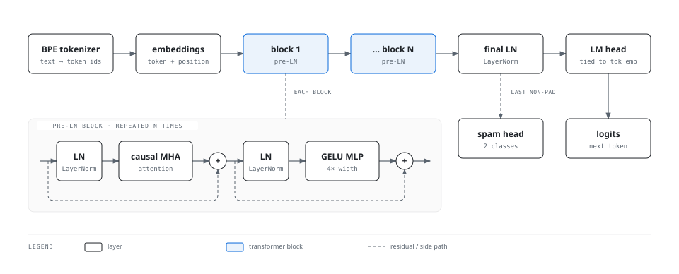
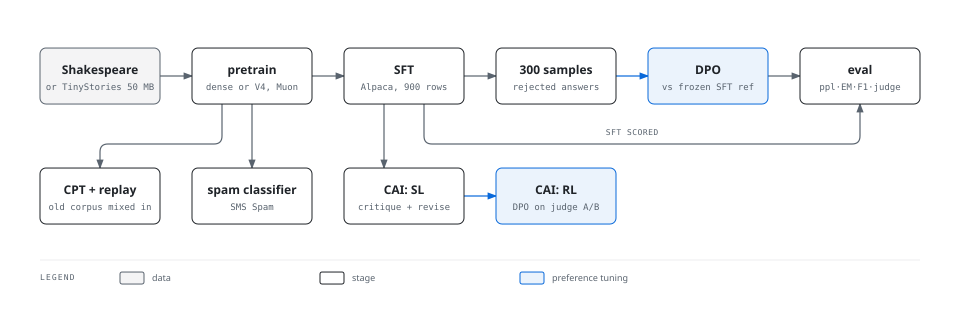
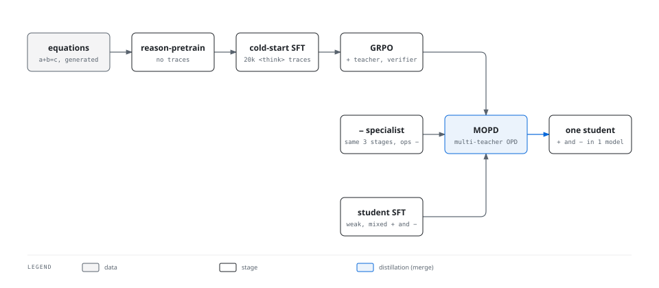
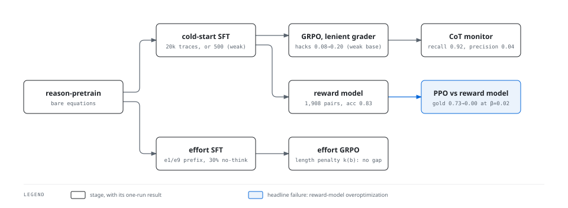

# minigpt — GPT from scratch

[](https://github.com/d41sys/minigpt/actions/workflows/ci.yml)

A small GPT built step by step in PyTorch: a byte-level BPE tokenizer, the
transformer, pretraining, loading real GPT-2 weights, classifier fine-tuning, SFT
and DPO. Only `torch.nn` primitives are used (Linear, Embedding, LayerNorm). The
tokenizer, attention, training loop, loss masking and DPO loss are all written here.

## Problem

Each stage of a modern LM pipeline is shown as a small, testable module:

| Stage | Module | What it shows |
|---|---|---|
| Tokenizer | `bpe.py` | byte-level BPE trainer/encoder/decoder, GPT-2 pre-tokenisation regex, JSON save/load, special tokens |
| Data | `data.py` | sliding-window `(x, y)` next-token dataset |
| Model | `model.py` | token + learned position embeddings (or RoPE via `--pos-encoding rope`), own causal MHA (optional `F.scaled_dot_product_attention`), pre-LN blocks, GELU MLP, weight-tied head, `generate(temperature, top_k)` with a per-layer KV cache (O(T) per new token instead of O(T²); falls back to crop-and-recompute past the context length) |
| Training | `train.py` | AdamW (decay on 2-D weights only), linear warmup + cosine LR, clip 1.0, periodic eval, best-val checkpoint, device mps → cuda → cpu |
| Pretrained | `pretrained.py` | HF GPT-2 124M safetensors → `GPTConfig(50257, 1024, 768, 12, 12)`, Conv1D transposes |
| Classifier | `finetune_cls.py` | head swap to 2 classes; train last block + final LN + head on UCI SMS Spam (balanced, 70/10/20) |
| SFT | `sft.py` | Alpaca prompt template, prompt tokens masked with `-100` |
| DPO | `dpo.py` | DPO loss (β = 0.1) against a frozen reference; pairs = dataset answer (chosen) vs SFT sample (rejected) |
| Constitutional AI | `cai.py` | judge-LLM critique/revise (SL) and A/B preference labels (RL) under random constitution principles; Ollama judge behind an injectable `ChatJudge` protocol |
| Reasoning tasks | `reason.py` | verifiable `a+b` / `a-b` tasks with column `<think>` traces, program-checked rewards, rollout and log-prob helpers, greedy eval per digit count |
| GRPO | `grpo.py` | group-relative advantages, PPO clip, k3 KL to the SFT reference; Dr. GRPO, V3.2 unbiased KL, batch fill and effort-conditioned length-penalty options |
| OPD | `opd.py` | full-vocabulary reverse-KL on-policy distillation, one teacher per operator |
| CoT monitor | `monitor.py` | lenient grader that can be hacked and a monitor that flags traces whose work disagrees with the answer |
| RLHF | `rlhf.py` | Bradley-Terry reward model on the policy's own samples, PPO with GAE and a per-token KL penalty |
| Eval | `evaluate.py` | perplexity, exact match, token F1, likelihood ranking, `Judge` protocol with an offline `MockJudge` and an Ollama LLM judge (1-5), weighted `EvalReport` |

## Architecture





## Data and licences

Datasets are downloaded at run time from their sources. The only redistributed data are the Alpaca rows in `docs/judge-eval/` (`dpo_pairs.json`, `rows.json`, `rows_nll.json`), under CC BY-NC 4.0 with attribution to [tatsu-lab/stanford_alpaca](https://github.com/tatsu-lab/stanford_alpaca).

| Data | Source | Licence |
|---|---|---|
| tiny-Shakespeare | [karpathy/char-rnn](https://github.com/karpathy/char-rnn) | public-domain text |
| Alpaca (SFT, DPO) | [tatsu-lab/stanford_alpaca](https://github.com/tatsu-lab/stanford_alpaca) | CC BY-NC 4.0, research use only; so are the SFT and DPO checkpoints derived from it |
| SMS Spam Collection | [UCI ML Repository](https://archive.ics.uci.edu/dataset/228/sms+spam+collection) | CC BY 4.0 |
| GPT-2 124M weights | [Hugging Face `gpt2`](https://huggingface.co/openai-community/gpt2) | OpenAI's modified MIT licence |

## Quickstart

Run from the repo root. Downloads go to `data/raw/`, outputs to `runs/` (both gitignored).

```bash
uv run minigpt train-tokenizer                     # BPE, vocab 1024, on tiny-Shakespeare
uv run minigpt pretrain --steps 2000              # random-offset windows; --sampling aligned = old recipe
uv run minigpt pretrain --batch-size 16 --grad-accum 2 --bf16   # 2 micro-batches of 16 per step; bf16 autocast, no GradScaler
uv run minigpt pretrain-eval                       # val-half and test-half loss of runs/pretrain/ckpt.pt
uv run minigpt generate --prompt "ROMEO:"
uv run minigpt data spam && uv run minigpt finetune-cls
uv run minigpt data alpaca && uv run minigpt sft
uv run minigpt dpo
uv run minigpt cai-data --stage sl && uv run minigpt cai-train --stage sl   # Constitutional AI (judge on :11434)
uv run minigpt cai-data --stage rl && uv run minigpt cai-train --stage rl
uv run minigpt eval
uv run minigpt eval --n 100 --paired-vs sft --checkpoints sft=runs/sft/ckpt.pt,dpo=runs/dpo/ckpt.pt
uv run minigpt reason-pretrain && uv run minigpt reason-sft && uv run minigpt reason-eval   # addition base model, runs/reason_*
uv run minigpt grpo                                # GRPO from runs/reason_sft, writes runs/grpo
uv run minigpt hack-demo                           # GRPO against a hackable grader + CoT monitor
```

Tests: `uv run pytest -q` (CI runs ruff, mypy and pytest on pushes to `main` and on every PR). Release: push a tag `vX.Y.Z` matching `pyproject.toml`'s version; CI reruns, then the wheel and sdist are attached to a GitHub Release. The GPT-2 parity test
needs internet and the extras:
`uv run --extra hf --extra test pytest -m network`.

## Results

All numbers come from one run on an Apple-silicon Mac (`device=mps`), seed 0, with the
CLI defaults. The model is 6 layers, d=256, 8 heads, context 256, 5.07M params, BPE vocab 1024.

All checkpoints were retrained from scratch after the repo split: pretrain, SFT and the spam classifier reproduce the earlier numbers exactly; DPO's epoch-2 loss and reward accuracy differ slightly (0.2427 / 0.940 vs 0.2314 / 0.95 before), cause not identified (same-seed reruns reproduce every metric and greedy response, but their weights differ by about 1e-5, so the cause may be run-to-run floating-point noise on MPS).

Published tokenizer stats and every result below predate the fix that stopped the BPE pre-tokenizer from dropping `_` (`snake_case` used to decode as `snakecase`). Retraining the tokenizer changes its merges, so those numbers do not reproduce on current code until the server runs are redone. The eval's Shakespeare perplexity also used to skip the last partial batch and now includes it.

| Experiment | Metric | Result |
|---|---|---|
| BPE on tiny-Shakespeare | vocab / compression | 1024 tokens, 2.41 bytes/token (17 s to train) |
| Pretrain, 2000 steps (about 6 min), aligned windows | test loss / perplexity of the val-selected checkpoint (step 800), 3 seeds | **3.875 / 48.2** (seeds 3.872 to 3.879); the earlier selection-biased "val 3.648 / ppl 40.27" is superseded |
| Pretrain, random-offset windows (new default) | same, 3 seeds | **3.767 / 43.2** (Δ −0.109, per-seed CIs exclude 0), see [overfitting section](#pretraining-overfitting-and-a-selection-biased-headline) |
| SMS Spam, head swap (790,786 trainable params) | test accuracy / F1 (n=300) | **0.940** / 0.939 (precision 0.965, recall 0.914) |
| SFT, Alpaca 900 rows × 3 epochs | train loss | 4.286 → 3.453 |
| DPO, 300 pairs, β=0.1, 2 epochs | loss at step 1 / epoch 2 mean | 0.6931 (= log 2) / 0.2427; reward accuracy 0.940 |
| GPT-2 124M parity (network test) | greedy 10 tokens vs HF `transformers` | identical (test passes) |
| Unit tests | `pytest` | 118 passed, 1 deselected (network) in 9 s on CI |

### Evaluation pipeline

`minigpt eval` runs four evals on every checkpoint and combines them into one weighted score:

- **Perplexity** on the held-out Alpaca responses (prompt tokens masked), mapped to [0, 1] as `1 − ln(ppl) / ln(vocab)` (1 = perfect, 0 = uniform guessing). Shakespeare perplexity is printed alongside but not aggregated.
- **Exact match** (SQuAD normalisation) on held-out Alpaca rows whose reference has ≤ 5 words (12 rows).
- **Token F1** on the first 50 held-out Alpaca rows by default; `--n 100` scores all 100 held-out rows.
- **Judge** (1–5) on the same rows. The default `MockJudge` maps ROUGE-L F1 onto the rubric so the eval runs offline; it duplicates token F1, so it is printed but **not aggregated**. `--judge ollama` swaps in a real LLM judge (`OllamaJudge`, see "Real LLM judge" below), which is aggregated by default.
- **Likelihood ranking** (printed, **not aggregated**): for each of the 100 held-out rows, does the model give the row's own reference a higher log-probability than the reference of row `(i+37) % 100` (the distractor scheme of [`judge_check.py`](docs/judge-eval/judge_check.py)) as the continuation of prompt `i`? Reported as accuracy with a Wilson 95% CI (chance 0.5), twice: summed log-probability, which favours short answers, and per-token (length-normalised). The gap between the two is the length bias. Built on the SFT example builder and `dpo.compute_sequence_log_probs`.
- **Stop rate** (printed, not aggregated): `stopped k/n`, how many of the greedy responses (at most 60 new tokens) ended with the end-of-text token instead of running to the limit.

The aggregate is the unweighted mean of perplexity score, EM and token F1 (`--w-ppl --w-em --w-f1` default 1, `--w-judge` default 0). `minigpt eval --checkpoints pretrain=runs/pretrain/ckpt.pt,sft=...`. Add `--paired-vs sft` for a paired bootstrap CI of each other checkpoint's per-row token F1 minus SFT (95% percentile CI, 10,000 row resamples, bootstrap p Holm-adjusted across the compared checkpoints) and `--rows-out PATH` to save per-row F1 and responses:

| Model | Alpaca ppl (held-out) | Shakespeare ppl | EM (n=12) | Token F1 (n=50) | Mock judge (ROUGE-L, 1-5) | Aggregate |
|---|---|---|---|---|---|---|
| pretrain | 409.23 | 40.27 (full validation split, on which this checkpoint was selected; test half: 48.20) | 0.000 | 0.048 | 1.00 | 0.060 |
| sft | 39.45 | 93.31 | 0.000 | 0.057 | 1.10 | 0.176 |
| dpo β=0.05 | 41.46 | 90.12 | 0.000 | 0.035 | 1.04 | 0.166 |
| dpo β=0.1 | 40.81 | 89.33 | 0.000 | 0.054 | 1.08 | 0.173 |
| dpo β=0.5 | 39.33 | 88.60 | 0.000 | 0.058 | 1.14 | 0.176 |

Reading, as measured:
- SFT cuts held-out Alpaca perplexity tenfold (409 → 39) and doubles Shakespeare perplexity (40 → 93): it learns the instruction format and forgets the pretraining domain. Almost all of the aggregate gain comes from this perplexity term.
- A 5M-parameter model trained on 900 instructions gets no exact match and near-floor F1; the generation metrics barely separate the checkpoints.
- An earlier version of this table measured perplexity on Shakespeare only, which ranked pretrain first. That compared the models on a domain SFT is meant to leave, so it was replaced.

#### Real LLM judge: Qwen 3.6 27B

`minigpt eval --judge ollama --judge-url http://HOST:11434 --judge-model qwen3.6:27b-ctx4k` scores each response against its reference with a fixed 1–5 rubric (`JUDGE_RUBRIC` in `evaluate.py`). The call uses Ollama's native `/api/chat` with temperature 0, seed 0, thinking off and a JSON schema that only admits an integer 1–5; any other reply raises instead of being guessed.

Run: the whole pipeline above retrained on one RTX 4090 (`device=cuda`, torch 2.13 cu129), then scored on all 100 held-out rows with `qwen3.6:27b-ctx4k` (Ollama model ID `7d4e56429f65`, Q4). Script, environment, per-row scores and every response: [`docs/judge-eval/`](docs/judge-eval/).

| Model | Alpaca ppl | Shakespeare ppl | EM (n=12) [95% CI] | Token F1 (n=100) [95% CI] | Qwen judge (n=100) [95% CI] | Aggregate (4 parts) |
|---|---|---|---|---|---|---|
| pretrain | 404.97 | 40.00 | 0.000 [0.000, 0.242] | 0.042 [0.034, 0.050] | 1.00 [1.00, 1.00] | 0.044 |
| sft | 39.92 | 93.41 | 0.000 [0.000, 0.242] | 0.046 [0.036, 0.057] | 1.00 [1.00, 1.00] | 0.129 |
| dpo β=0.05 | 42.51 | 90.51 | 0.000 [0.000, 0.242] | 0.062 [0.050, 0.075] | 1.00 [1.00, 1.00] | 0.130 |
| dpo β=0.1 | 41.61 | 90.16 | 0.000 [0.000, 0.242] | 0.057 [0.046, 0.068] | 1.00 [1.00, 1.00] | 0.130 |
| dpo β=0.5 | 39.50 | 91.04 | 0.000 [0.000, 0.242] | 0.061 [0.050, 0.073] | 1.00 [1.00, 1.00] | 0.133 |

CIs (printed by `eval` since this run): EM uses a Wilson interval over the 12 rows, token F1 and the judge a 10,000-resample row bootstrap of the mean. 0 of 12 exact matches is compatible with a true EM rate of up to 24%, so EM cannot separate these models at all. The judge's [1.00, 1.00] is a degenerate bootstrap (100 identical scores leave nothing to resample), not certainty; the informative bound is the share of responses scoring above 1: 0 of 100, Wilson 95% CI [0, 0.037] per checkpoint. A second scoring run of the same checkpoints (with the CI code) reproduced every response and every judge score exactly ([`rows.json`](docs/judge-eval/rows.json)). The 300 DPO preference pairs of this run are in [`dpo_pairs.json`](docs/judge-eval/dpo_pairs.json).

**The judge gives 1 to all 500 responses.** Two checks show this is a verdict, not a stuck judge ([`judge_check.json`](docs/judge-eval/judge_check.json)):

| Check (100 held-out rows) | Expected | Mean score | Share |
|---|---|---|---|
| Reference answer judged against itself | 5 | 4.88 | 97% score 5 |
| Another row's reference judged against this row's | 1 | 1.00 | 100% score 1 |

What it changes:
- **Token F1 differences are filler-word overlap.** The five highest-F1 responses (F1 ≈ 0.25) are text like "The collollolly of the collollos of the 10000…". Their overlap with the reference is "the", "of", "is".
- **The token-F1 verdict flips with the hardware.** On this CUDA run the paired test calls DPO β=0.05 and β=0.5 *better* than SFT (Δ +0.016 and +0.015, Holm p 0.049 and 0.007); on the earlier MPS run every DPO variant was at or below SFT. Same seeds and datasets; the floating-point paths differ, and so do the preference pairs sampled from each SFT model. The sign flips. A metric whose significant result reverses across devices is measuring noise in gibberish, so neither verdict says anything about quality. This CUDA run was not pre-registered, so the pre-registered MPS verdict above (no detectable difference) stands; the flip is reported as a replication discrepancy.
- **All five checkpoints are at the judge's floor.** SFT and DPO change perplexity and the answer format, not answer quality, at 5M parameters trained on Shakespeare. Rank agreement between judge and token F1 is undefined because every judge score is the same.
- Training on CUDA reproduced the MPS run closely: SFT loss 4.292 → 3.474 (MPS 4.286 → 3.453), DPO β=0.1 epoch-2 loss 0.2412 and reward accuracy 0.940 (MPS 0.2427, 0.940), pretrain test loss 3.844 (MPS 3.875).
- **Contamination check** ([`contamination.py`](docs/judge-eval/contamination.py), [`contamination.json`](docs/judge-eval/contamination.json)): 4 of the 100 held-out rows (12, 17, 26, 87) share at least one lowercase word 8-gram (instruction + input + answer) with the 900 SFT/DPO training rows, 0 with tiny-Shakespeare, and no held-out instruction appears verbatim in training. Dropping the 4 rows moves every checkpoint's mean token F1 by at most 0.0015 (e.g. SFT 0.046 → 0.048, DPO β=0.1 0.057 → 0.055), so overlap does not drive any number above. Whether the 4 overlaps are leaks or shared stock phrases was not inspected.

Pretrain log (excerpt; seed 0, `--sampling aligned --dropout 0.1`, the recipe that produced `runs/pretrain/ckpt.pt`; val = first half of the held-out 10%):

```text
device=mps train_tokens=414,007 val_tokens=23,000 test_tokens=23,001
params=5,066,752
step     0 train 6.9923 val 6.9426 lr 1.00e-05
step   400 train 3.5398 val 3.7873 lr 9.46e-04
step   800 train 2.9612 val 3.5264 lr 7.31e-04
step  1200 train 2.3985 val 3.6315 lr 4.40e-04
step  1999 train 1.8529 val 3.9659 lr 1.00e-04
val loss step0=6.9964 best=3.5264 drop=49.6%
val-selected checkpoint (step 800): val loss=3.5264 ppl=34.00 (n=89 windows)  test loss=3.8754 ppl=48.20 (n=89 windows)
```

`minigpt generate --prompt "ROMEO:"`:

```text
ROMEO:
It's name, my wilt bend?

ROMEO:
Ay, the dead; and I would thou wilt swear,
I fear thy sound not that thou shouldst wilt say it thee.

ROMEO:
Then, sin me, thou art a man that thou art a torment,
To have thee in thee to death; let
```

SFT sample on a held-out instruction (greedy):

```text
### Instruction: Calculate the cost of 4 apples at $2.50 each.
### Model: The calcon is 1000.
### Reference: The cost of 4 apples at $2.50 each is $10.00.
```

How to read these results:
- **Overfitting.** About 414k training tokens is small for 5M params. Val loss bottoms out at step 800 and rises after that while train loss keeps falling. The checkpoint keeps the best-val weights, so every downstream stage starts from step 800 of the aligned-window run. Random-offset windows reduce but do not remove this (see the pretraining section below).
- **SFT.** The model learns the response *format*: short declarative answers that reuse words from the instruction. It cannot learn facts or arithmetic, because it was pretrained only on Shakespeare.
- **DPO.** It learns the preference: reward accuracy rises with β and the loss always starts at exactly log 2. Held-out quality does not move detectably. All runs train on the **same 300 preference pairs** (sampled once, saved to `runs/dpo/pairs.json`, reused via `--pairs-file`), so only β or the seed differs:

  | Checkpoint | DPO loss (epoch 2) | Reward acc. | Token F1 (n=50) | Mock judge (1-5) |
  |---|---|---|---|---|
  | sft | – | – | 0.057 | 1.10 |
  | β=0.05, seed 0 | 0.386 | 0.923 | 0.035 | 1.04 |
  | β=0.1, seed 0 | 0.243 | 0.940 | 0.054 | 1.08 |
  | β=0.1, seed 1 | 0.243 | 0.940 | 0.048 | 1.10 |
  | β=0.1, seed 2 | 0.236 | 0.940 | 0.042 | 1.02 |
  | β=0.5, seed 0 | 0.051 | 0.977 | 0.058 | 1.14 |

  **Paired test on all 100 held-out rows.** The n=50 point values above carry no uncertainty, so every existing DPO checkpoint was re-scored on all 100 held-out rows (greedy, 60 new tokens) and compared with SFT by a paired bootstrap on per-row token F1 (10,000 row resamples, seed 0). The rule was fixed before scoring ([`docs/protocol-dpo-paired-bootstrap.md`](docs/protocol-dpo-paired-bootstrap.md)): a variant is **different** from SFT only if its 95% CI excludes 0 **and** its Holm-adjusted p (Holm over all 10 existing DPO checkpoints) is below 0.05; otherwise it is **no detectable difference**. SFT token F1 on the 100 rows is 0.069 (0.057 on the first 50).

  | Checkpoint | F1 (n=100) | F1 (first 50) | Δ F1 vs SFT | 95% CI | p | p (Holm) | Verdict |
  |---|---|---|---|---|---|---|---|
  | β=0.05, seed 0 | 0.054 | 0.035 | -0.0150 | [-0.0292, -0.0010] | 0.0364 | 0.364 | no detectable difference |
  | β=0.1, seed 0 | 0.068 | 0.054 | -0.0013 | [-0.0156, +0.0133] | 0.8685 | 1.000 | no detectable difference |
  | β=0.1, seed 1 | 0.063 | 0.048 | -0.0060 | [-0.0197, +0.0075] | 0.3916 | 1.000 | no detectable difference |
  | β=0.1, seed 2 | 0.055 | 0.042 | -0.0139 | [-0.0283, +0.0004] | 0.0550 | 0.440 | no detectable difference |
  | β=0.5, seed 0 | 0.065 | 0.058 | -0.0037 | [-0.0146, +0.0068] | 0.4896 | 1.000 | no detectable difference |

  Ten checkpoints were scored (`runs/dpo`, `runs/dpo_b*`, `runs/fx_*`), but they are five distinct models: β=0.1 seed 0 exists four times (`dpo`, `dpo_b0.1`, `fx_b0.1_a`, `fx_b0.1_b`), β=0.05 and β=0.5 twice each (`dpo_b*`, `fx_b*_a`). Same-seed reruns differ in weights by about 1e-5 (so the pre-registration's "none bit-identical, none merged" check passed), yet every one of the 100 greedy responses is identical within each group, so each group gives one row above and the same CI. The Holm adjustment was applied over the 10 pre-registered rows, as written. Merging the duplicates (**post-hoc**, 5 comparisons) gives Holm p of 0.182 (β=0.05), 0.220 (β=0.1 seed 2) and 1.0 for the rest, so the verdicts do not change.

  No variant is different from SFT, and every point estimate is below SFT. "No β improves on SFT" holds, but with 100 rows the CIs are about ±0.014 F1 wide, so a small gain or loss is not excluded: β=0.05 has a raw 95% CI that excludes 0 on the negative side (and β=0.1 seed 2 only just includes it), which does not survive Holm over 10 comparisons. The rows are the only source of uncertainty here: the 300 pairs and each seed's training are fixed, so the CIs do not cover variation across training seeds or pair samples (the seed spread above is a separate, rough look at that). The rejected samples come from the same weak model, so DPO mostly learns to move away from its own outputs: it optimises likelihood margins, not answer quality. Reported as measured.

  **NLL regulariser (Llama 3), exploratory, not pre-registered.** `minigpt dpo --nll-alpha 0.2` adds 0.2 × the length-normalised NLL of the chosen answers to the DPO loss (Llama 3 paper, section 4.1.4), and every run now logs the policy's per-token log-prob of chosen and rejected answers against the reference. Same 300 pairs ([`dpo_pairs.json`](docs/judge-eval/dpo_pairs.json)), β=0.1, 2 epochs, CUDA ([logs](docs/judge-eval/), [`rows_nll.json`](docs/judge-eval/rows_nll.json)):

  | Checkpoint | Epoch-2 DPO loss | Reward acc. | Chosen log-prob/token vs ref | Rejected vs ref | Alpaca ppl | Token F1 Δ vs SFT [95% CI], Holm p | Qwen judge |
  |---|---|---|---|---|---|---|---|
  | DPO | 0.2412 | 0.940 | **−0.054** | −0.694 | 41.61 | +0.010 [−0.004, +0.025], 0.145 | 1.00 |
  | DPO + NLL (α=0.2) | 0.2337 | 0.960 | **+0.068** | −0.476 | 39.69 | +0.011 [+0.001, +0.021], 0.074 | 1.00 |

  Plain DPO lowers the likelihood of the answers it is told to prefer; the NLL term reverses that and keeps held-out Alpaca perplexity at SFT level (SFT 39.92). Held-out quality does not move: both are no detectable difference from SFT on token F1 (Holm over 2), and the judge scores every response 1. The plain-DPO row is a rerun of the β=0.1 checkpoint above and reproduces its eval row exactly.

### Pretraining: overfitting and a selection-biased headline

The earlier headline (val loss 3.648, perplexity 40.27) picked the best of 11 validation evaluations and reported that same minimum, so it is optimistically biased. The model also overfits: the train set is 414k tokens in non-overlapping windows (about 40 epochs in 2000 steps) and val loss turns up after step 800. The held-out 10% is now cut deterministically into contiguous **val** (first 23,000 tokens, selects the checkpoint) and **test** (last 23,001 tokens, reported only). Protocol, written before any run: [`docs/protocol-pretrain-regularization.md`](docs/protocol-pretrain-regularization.md). Raw per-run JSON and `summary.json`: `docs/pretrain-regularization/`. Reproduce with `minigpt pretrain --name pre_<variant>_s<seed> --seed <seed> [--sampling aligned] [--dropout 0.2] --results-out ...` and `minigpt pretrain-compare`.

Headline, corrected: the val-selected baseline checkpoint has **test loss 3.875 (perplexity 48.2)**, mean over seeds 0, 1, 2 (range 3.872 to 3.879). The seed-0 rerun reproduces the checkpoint used downstream: same selected step (800) and the existing `runs/pretrain/ckpt.pt` scores the same on both halves under `minigpt pretrain-eval` (val 3.5264, test 3.8754). So 3.648 / 40.27 understated the loss by about 0.23 nats; the halves differ in difficulty (val 3.53 vs test 3.88), so part of that gap is the split and not only selection.

Tokenizer-independent: `pretrain-eval` also prints **bits per byte** (loss in bits times tokens per byte of that half). The test half has 2.298 bytes/token, so test loss 3.875 is **2.433 bits/byte** (random-offset mean 3.767: 2.365). Measured directly on the CUDA retrain (test loss 3.844): 2.414. For scale, nanoGPT's character-level Shakespeare baseline reports val loss 1.4697 nats/char, about 2.12 bits/char; that model is larger and uses a different split, so this is an order-of-magnitude comparison, not a ranking.

Three variants, seeds 0, 1, 2, same 2000-step budget, one factor changed at a time, selected on val, scored on test. `base`: aligned windows, dropout 0.1. `randoff`: random-offset windows (stride-1 windows, shuffled). `drop02`: aligned, dropout 0.2. Δ is test loss minus the same-seed baseline; the CI is a paired bootstrap over the 89 test windows (10,000 resamples), so it reflects test-set sampling noise only.

| Variant | seed | selected step | test loss (ppl) | Δ test vs base [95% CI] |
|---|---|---|---|---|
| base | 0 / 1 / 2 | 800 / 800 / 800 | 3.8754 (48.20) / 3.8785 (48.35) / 3.8720 (48.04) | n/a |
| drop02 | 0 | 1200 | 3.8282 (45.98) | −0.047 [−0.064, −0.030] |
| drop02 | 1 | 1400 | 3.8539 (47.17) | −0.025 [−0.041, −0.008] |
| drop02 | 2 | 1200 | 3.8408 (46.56) | −0.031 [−0.047, −0.016] |
| randoff | 0 | 1200 | 3.7408 (42.13) | −0.135 [−0.153, −0.116] |
| randoff | 1 | 1400 | 3.7646 (43.14) | −0.114 [−0.135, −0.093] |
| randoff | 2 | 1200 | 3.7946 (44.46) | −0.077 [−0.101, −0.053] |

Pre-registered rule: adopt a variant only if, on every seed, its test loss is lower than the baseline by at least 0.05 **and** the per-seed 95% CI excludes 0. `randoff` meets it on all three seeds (mean test loss 3.767, Δ −0.109); `drop02` does not (its gain is 0.025 to 0.047 on every seed, below the 0.05 margin). **Decision: random-offset sampling is the new default; dropout stays 0.1.** `--sampling aligned` restores the old windows. Neither variant removes the overfitting: val loss still rises after its minimum (`randoff` ends at val 3.41 to 3.42 vs minimum 3.35 to 3.37). The test half is 23k tokens of one contiguous passage adjacent to the validation half, so this is a within-corpus hold-out. The 0.05 margin and the choice of variants were fixed before the runs; nothing in this section is post-hoc.

The default change affects only new runs. SFT, DPO, the spam classifier and the eval tables in this README were trained from the old aligned-window checkpoint (`runs/pretrain/ckpt.pt`, not overwritten) and are **not retrained**; a bare `minigpt pretrain` no longer reproduces that checkpoint (use `--sampling aligned`).

## Post-training stages

Small-scale copies of post-training stages that labs describe publicly, run on verifiable arithmetic tasks ([`reason.py`](src/minigpt/reason.py)). The sources are cited for the stage's shape only; nothing here claims to reproduce their results. One-run results are in the table at the end of this section.





### Reasoning base: pretrain, cold-start SFT, eval

`reason-pretrain` trains a 4-layer, d=128 GPT on 50,000 bare equations `a+b=c` (digits 1-4, byte-level tokens); `reason-sft` then fine-tunes it on 20,000 reference traces `<think>7+5+0=12 4+8+1=13</think><answer>132</answer>` (digits 1-3, 3 epochs) with the prompt masked, reusing `sft.train_sft`. This is the "SFT followed by RL" start of [DeepSeek-V4.1](https://huggingface.co/deepseek-ai/DeepSeek-V4.1-Flash/blob/main/DeepSeek_V41_Tech_Report.pdf) §5.1. The first default, 500 traces × 15 epochs, learned the format but not to copy operands (`9+4=` → `<think>8+7+0=14…`; 1-digit accuracy 0.20), which left RL nothing to sharpen.
Run: `minigpt reason-pretrain && minigpt reason-sft` (writes `runs/reason_pretrain`, `runs/reason_sft`), then `minigpt reason-eval --checkpoint runs/reason_sft/ckpt.pt`: greedy decoding on 50 fixed seeded tasks per digit count 1-5, reporting accuracy, format rate and mean completion tokens (`reason.evaluate_reasoning`).
Lesson to test: the SFT model is trained on 1-3 digits only, so 4-5 digit rows show whether it learned the column procedure or memorised short sums.

### GRPO with verifiable rewards

Per step: sample tasks from a digit range, draw G completions each, reward = accuracy + 0.1 · format, advantage = `(r − group mean) / (std + eps)`, PPO-clipped ratio against the sampling policy plus β · k3 KL to the frozen SFT model ([`grpo.py`](src/minigpt/grpo.py)). Groups whose rewards are all equal have zero advantage and are dropped (the drop rate is logged). Mirrors the RL stage of [DeepSeek-V4.1](https://huggingface.co/deepseek-ai/DeepSeek-V4.1-Flash/blob/main/DeepSeek_V41_Tech_Report.pdf) (§5.1 "SFT followed by RL and on-policy distillation" with no algorithmic novelty, verifiable tasks with difficulty calibration and filtering; §5.2 GRPO groups).
Run: `minigpt grpo` (200 steps, B=8 tasks, G=8; writes `runs/grpo/ckpt.pt` and `history.json` with reward, accuracy, format, length, KL and drop rate per step). `--no-std-norm` and `--loss-agg token-sum` are the Dr. GRPO variants; `--mu` sets inner epochs. `--ops -` trains the subtraction specialist (`--base`, `--out` point at its own checkpoints).
Lesson to test: length bias (§5.2.2, short samples dominate early batches). `seq-mean` divides each sequence by its own length, so tokens of short completions weigh more; `token-sum` divides by one constant. Compare the `length` column of the two runs.

### Controllable reasoning effort

[DeepSeek-V4.1](https://huggingface.co/deepseek-ai/DeepSeek-V4.1-Flash/blob/main/DeepSeek_V41_Tech_Report.pdf) §5.1.4 puts an effort level `b` in the prompt and makes the length penalty depend on it, so one checkpoint trades reasoning length for accuracy on request. Here the prompt is `e9:12+34=` (prefix built outside `Task`, `reason.effort_prefix`). `grpo --efforts 1,9` samples every task once per level, so each (task, level) is its own group and advantages are centred within it; levels are never compared. The reward gains `r_len = −min(C_max, k(b) · l / L_norm)`, `l` = characters inside `<think>` (one token each), `k(b) = k0 · exp(−(b − b_min) / τ)`, `τ = λ · Δb` with Δb the mean level spacing. `--effort-k0` is `k0`; `L_norm=30`, `C_max=1`, `λ=0.25` are constants in `grpo.py`. The record logs `think_e{b}` and `acc_e{b}` per level.
Cold start: `reason-sft --efforts 1,9 --nothink-frac 0.3` gives each trace a random prefix and makes 30% of them the non-think form `<think></think><answer>N</answer>`, drawn independently of the level, so only RL can learn which level should skip the think block. Run: `minigpt reason-sft --efforts 1,9 --nothink-frac 0.3 --out runs/effort_sft/ckpt.pt`, `minigpt grpo --base runs/effort_sft/ckpt.pt --efforts 1,9 --effort-k0 2.0 --lr 1e-4 --steps 250 --out runs/effort_grpo/ckpt.pt`, `minigpt reason-eval --checkpoint runs/effort_grpo/ckpt.pt --efforts 1,9` (accuracy and mean think tokens per level and digit count). Without `--efforts` everything behaves as before.

### CoT monitor and reward hacking

`hack-demo` runs the same GRPO from the same SFT checkpoint but with a deliberately hackable grader, `lenient_reward` ([`monitor.py`](src/minigpt/monitor.py)): it gives 1.0 when the true answer appears as a substring anywhere in the completion, so `<answer>0</answer> 132` scores 1.0 for 47+85. The history tracks the proxy reward and the true `accuracy_reward`; their gap is the reward hacking. A rule-based CoT monitor flags a completion when the think steps do not compute the stated answer (it recomputes each column and carry) or when content sits outside the format, and the run reports its flag rate plus its precision and recall against "proxy reward 1 and true reward 0". Mirrors the chain-of-thought monitoring and metagaming findings of the [GPT-6 Astra system card](https://deploymentsafety.openai.com/gpt-6-astra), the note in the [Claude Opus 5.5 system card](https://www.anthropic.com/document/claude-opus-5-5-system-card) that some snapshots "concealed actions from an automated grader", and the grader "hackability" inspection of DeepSeek-V4.1 §5.1.
Run: `minigpt hack-demo` (writes `runs/hack_demo/ckpt.pt`, `history.json`). Lesson to test: whether the proxy rises while true accuracy stalls or falls, and whether the monitor flags the exploit before the proxy-true gap is obvious. The monitor sees only the completion, so a self-consistent trace for the wrong operands passes it.

### On-policy distillation (OPD)

The student samples its own completions and, at every completion token, minimises the full-vocabulary KL between its next-token distribution and a frozen teacher's on that same prefix ([`opd.py`](src/minigpt/opd.py)). Mirrors the last stage of [DeepSeek-V4.1](https://arxiv.org/html/2609.19969) (§5.2.4, full-vocabulary OPD); background: [MiniLLM](https://arxiv.org/abs/2306.08543) (Gu et al. 2024) and [Thinking Machines, "On-policy distillation"](https://thinkingmachines.ai/blog/on-policy-distillation/) (2025).
Run: `minigpt opd` (teacher `runs/grpo/ckpt.pt`, student `runs/reason_sft/ckpt.pt` or `--student-config 64,2,4`; writes `runs/opd/ckpt.pt`). `--kl forward` swaps the direction; `--off-policy` is the baseline where the teacher samples and the student does plain SFT on those samples (`runs/opd/off_policy/ckpt.pt`).
Lessons to test: reverse KL is mode-seeking (the student commits to one teacher mode) and forward KL is mode-covering; training on the student's own prefixes is meant to fix exposure bias, since an off-policy student never sees its own mistakes corrected. The history logs reverse KL per token, greedy accuracy and mean length on one fixed seeded task set for both modes.

### Multi-teacher OPD: addition + subtraction

A second domain, subtraction `a-b` with a ≥ b (so no negative answers), has its own trace: one step per column, right to left, `x-y-borrow=s` where `s` may be negative, the digit is `s mod 10` and the next borrow is 1 when `s < 0`. `52-38=` → `<think>2-8-0=-6 5-3-1=1</think><answer>14</answer>` ([`reason.py`](src/minigpt/reason.py)). `--ops` (comma list, default `+`; `--ops +,-` draws each task's operator uniformly) is accepted by `reason-pretrain`, `reason-sft`, `grpo`, `reason-eval` and `opd`; `reason-eval` and `grpo` then also print accuracy per operator.
`minigpt opd --ops +,- --teacher +=runs/grpo/ckpt.pt --teacher=-=runs/sub_grpo/ckpt.pt` merges one specialist per operator into one student: each prompt is scored against the teacher of its operator, and the loss is the token-weighted mean of the per-teacher reverse KLs (a teacher's weight is its share of the batch's completion tokens, so the whole-batch per-token mean). `--teacher` is repeatable; a plain `PATH` is one teacher for every operator (the single-teacher default). Write a `-` operator as `--teacher=-=PATH`: argparse reads a separate `-=PATH` argument as an option. With `--off-policy` each prompt is sampled from its own operator's teacher. Teachers may differ in size from the student but must share its vocabulary. The history and the printed log report accuracy and reverse KL per operator as well as overall ([`opd.py`](src/minigpt/opd.py)). This is the shape of [DeepSeek-V4.1](https://arxiv.org/html/2609.19969) §5.2.4 (one specialist per domain, merged by full-vocabulary OPD), at two toy domains.

### Constitutional AI ([`cai.py`](src/minigpt/cai.py))

Not on addition tasks: this stage uses the Alpaca chat model from `runs/sft` and a judge LLM (Ollama) instead of a verifiable reward.

- **What:** the judge critiques the SFT model's answers against a random principle from a 7-line [constitution](docs/cai/constitution.md) and rewrites them; SFT on the rewrites is SL-CAI. The SL-CAI model then samples 2 answers per prompt, the judge picks the better one under a random principle (A/B order randomised, position-bias rate recorded), and DPO on those pairs is RL-CAI. 128 PG prompts in [`prompts.json`](docs/cai/prompts.json); the last 20 are held out for `cai-eval`.
- **Mirrors:** [Bai et al. 2022, Constitutional AI](https://arxiv.org/abs/2212.08073), the public method behind the Claude Opus 5.5 system card's statement that post-training aligns the model "with the values described in Claude's constitution". The constitution text is original, inspired by [Anthropic's](https://www.anthropic.com/constitution). One departure: DPO replaces the paper's preference model + RL.
- **Run** (needs `runs/sft` and the judge, e.g. `ssh -L 11434:localhost:11434 Korea`):

```bash
uv run minigpt cai-data --stage sl && uv run minigpt cai-train --stage sl   # writes runs/cai_sl
uv run minigpt cai-data --stage rl && uv run minigpt cai-train --stage rl   # writes runs/cai_rl
uv run minigpt cai-eval   # judge scores held-out prompts 1-5: sft vs cai_sl vs cai_rl
```

- **Lesson to test:** the labels are only as good as the judge reading a text file; `runs/cai/pairs_stats.json` shows how often it just picked the slot shown first.

### RLHF: reward model + PPO

Classic RLHF ([`rlhf.py`](src/minigpt/rlhf.py)): a program stands in for the human labeler (answer correct + format correct) and ranks `k` SFT samples per prompt; a Bradley-Terry reward model (SFT body + scalar head on the last non-pad token, 20% of pairs held out) is fit to the pairs; PPO then maximises its score with GAE (γ=1, λ=0.95), clipped policy and value losses, a per-token KL penalty to the SFT policy and a value head on the policy. Mirrors [InstructGPT](https://arxiv.org/abs/2203.02155) (Ouyang et al. 2022), the recipe DPO and GRPO later replaced; the Claude Opus 5.5 system card describes crowd workers doing preference selection, which the labeler program replaces here.
Run: `minigpt reward-model` (reads `runs/reason_sft/ckpt.pt`, prints held-out pairwise accuracy, writes `runs/rm/ckpt.pt`), then `minigpt ppo` (writes `runs/ppo/ckpt.pt` and `runs/ppo/history.json`; `--sft` on both points at another policy checkpoint).
Lesson to test ([Gao et al. 2022](https://arxiv.org/abs/2210.10760), reward-model overoptimization): the exact checker is a gold reward, so the history logs the proxy (reward-model) score next to gold accuracy, KL, value loss and length at every step. Overoptimization would show as the proxy still rising while gold accuracy falls from its peak; `minigpt ppo` prints both so a run can show it or not. The Claude Opus 5.5 card reports training snapshots that "concealed actions from an automated grader"; here the grader is learned and any exploit would live in the reward model.

### Results: one run on an M-series Mac (MPS), seed 0

Single seed, 50 greedy tasks per digit count (64 for OPD), so differences of a few points are noise. Logs are not committed; rerun the commands above.

| Stage | Result |
|---|---|
| `reason-sft` (20k traces, 53 s) | accuracy 1/2/3/4/5 digits: 0.98 / 0.94 / 0.86 / 0.00 / 0.00 |
| `grpo` (200 steps, 2.5 min) | 1.00 / 1.00 / 1.00 / 0.00 / 0.00. RL sharpened what SFT could already do; it cannot reach 4-5 digits, where every group is all-wrong and is dropped (zero advantage) |
| `grpo --unbiased-kl --no-std-norm` (DeepSeek-V3.2) and `grpo --fill-batch` (DAPO dynamic sampling), 200 steps each, same seed | No measurable effect. Strong SFT base: all three variants end at 1.00 / 1.00 / 1.00 on 1-3 digits; `--fill-batch` hit its 4-round cap every step late in training (97% of sampled groups all-correct), i.e. 4× the rollouts for the same result. Weak 500-trace base (SFT 0.20 / 0.04 / 0.00): baseline 0.14 / 0.04 / 0.00, V3.2 0.24 / 0.02 / 0.02, fill 0.22 / 0.00 / 0.02, all within the noise of 50 tasks; none learned. Both knobs change how RL uses signal, not whether the base can produce it |
| `reason-sft --efforts 1,9 --nothink-frac 0.3` then `grpo --efforts 1,9 --effort-k0 2.0 --lr 1e-4 --steps 250` (SFT 54 s, RL 9.5 min on a busy Mac) | greedy accuracy / think tokens at effort 1 → effort 9, digits 1/2/3: SFT start 0.86/0.74/0.58 → 0.94/0.78/0.60 acc, 6.1/14.4/19.4 → 6.6/14.7/19.4 think; after RL 0.96/0.94/0.90 → 0.94/0.98/0.96 acc, 0.0/15.3/23.3 → 0.0/16.0/24.8 think. **Inconclusive**: RL made both levels skip the think block on 1 digit and the levels differ by under 2 tokens on 2-3 digits (acc 0.90 vs 0.96 on 3 digits is 3 tasks out of 50). Two milder settings (`k0 0.5`, `k0 1.5` with λ 0.5) gave no gap at all. Likely cause: the only short behaviour here is answering directly, which fails on 2-3 digits, so the penalty has no cheaper-but-still-useful answer to buy |
| `hack-demo` | from this strong SFT the exploit never paid: hack rate 0.003 → 0.002, because correct answers already max the lenient grader. From the weak 500-trace SFT it did: hack rate 0.077 → 0.197 while true accuracy fell 0.048 → 0.001. Monitor recall 0.92, precision 0.04: hacks are rare here, so most flags land on ordinary wrong or malformed answers |
| `reward-model` | default (800 tasks, k=4): 232 pairs, held-out accuracy 0.500, chance, because most groups of 4 are all correct. Rerun with `--tasks 4000 --k 8 --max-digits 4 --epochs 6 --lr 1e-4`: 1,908 pairs, held-out accuracy **0.827** (6 min) |
| `ppo --rm` that 0.827 RM, β sweep (150 steps each, 10-step means) | β=0.02: RM score 5.8 → 8.5, gold accuracy 0.73 → 0.00, KL to SFT 117 nats/sequence; the final policy writes degenerate strings the RM scores high, e.g. `60+93=` → `<think>ansswer>1111/answer>`. β=0.1: score 5.8 → 6.9, gold 0.75 → 0.45, KL 13. β=0.3: score 6.1 → 6.1, gold 0.80 → 0.60, KL 4. A stronger KL penalty limits the damage, but gold fell at every β. The net PPO objective (score − β·KL) barely moved (5.75 → 6.13, 5.69 → 5.56, 6.04 → 4.72), so this is unstable PPO that drifts toward RM-favoured junk, not a clean Gao et al. curve. (Against the chance-level 232-pair RM, gold drifted 0.89 → 0.76; that run says nothing about overoptimization.) |
| `opd` | same-size student initialised from SFT: inconclusive, reverse KL was already 0.013 nats/token and greedy accuracy moved within noise (0.94 → 0.86 on-policy, 0.94 → 0.92 off-policy). Small random-init student (`--student-config 64,2,4`, 125k params, 400 steps): accuracy stayed 0.00 in both modes; on-policy reverse KL 15.0 → 10.7 nats/token, off-policy 15.0 → 4.4. On-policy distillation needs a student that already produces sensible prefixes, which is why it comes after SFT and RL |
| CAI (`qwen3:8b` judge on 20 held-out prompts) | adherence 1-5: sft 1.00, cai_sl 1.25, cai_rl 1.45, no CI. The RL-CAI labels picked the first-shown answer 86.1% of the time (93/108), so DPO mostly learned position noise |
| `reason-pretrain` / `reason-sft` / `grpo` with `--ops -` (subtraction specialist, 26 s + 42 s + 2.5 min) | accuracy 1/2/3/4/5 digits: SFT 0.98 / 0.80 / 0.70 / 0.00 / 0.00, after GRPO 1.00 / 0.98 / 0.98 / 0.00 / 0.00 (same pattern as addition: 4-5 digits are never learned) |
| `opd --ops +,-` with one teacher per operator | see the table below |

Multi-teacher OPD, `+` teacher `runs/grpo`, `-` teacher `runs/sub_grpo`, 1000 steps, batch 8 tasks, lr 3e-4, one seed. The student is `reason-pretrain --ops +,-` (50k equations) then `reason-sft --ops +,- --n 20000 --epochs 1` (14 s), deliberately weak. Smaller SFTs were too weak to be a useful start: 2,000 / 6,000 / 12,000 traces gave mixed-operator 1-digit accuracy 0.00 / 0.08 / 0.18. Accuracy is `reason-eval --ops OP` (greedy, 50 tasks per digit count, so about ±0.07 at 0.5); KL is reverse KL per completion token on the 200 held-out tasks of the OPD run itself (1-3 digits, about 100 per operator), scored against each task's own teacher.

| Model | `+` accuracy, 1/2/3 digits | `-` accuracy, 1/2/3 digits | held-out reverse KL, all / `+` / `-` |
|---|---|---|---|
| student SFT (before) | 0.20 / 0.08 / 0.00 | 0.42 / 0.06 / 0.00 | 0.663 / 0.702 / 0.628 |
| after on-policy OPD (13 min) | 0.90 / 0.14 / 0.02 | 0.74 / 0.20 / 0.00 | 0.300 / 0.318 / 0.284 |
| after off-policy (teacher-sampled SFT, 13 min) | 0.70 / 0.26 / 0.02 | 0.82 / 0.44 / 0.12 | 0.271 / 0.304 / 0.241 |
| `+` teacher (`runs/grpo`) | 1.00 / 1.00 / 1.00 | 0.00 / 0.00 / 0.00 | n/a |
| `-` teacher (`runs/sub_grpo`) | 0.04 / 0.00 / 0.00 | 1.00 / 0.98 / 0.98 | n/a |

Both modes cut the held-out KL by more than half and raised greedy accuracy on the OPD held-out set (0.230 → 0.330 on-policy, → 0.405 off-policy), in both operators, mostly at 1 digit; 2-3 digits stay far below the teachers. On this seed and these 200 tasks the two modes are not distinguishable on overall accuracy, and off-policy was ahead on `-` at 2-3 digits (0.44 / 0.12 vs 0.20 / 0.00), so this run does not show an on-policy advantage. The 1000-step runs shared the GPU (run concurrently, 13 min each; a 300-step run alone took 7.2 min on-policy and 6.2 min off-policy). 300-step runs (64 held-out tasks, noisier): KL 0.692 → 0.465 on-policy, → 0.504 off-policy; accuracy 0.188 → 0.219 and → 0.328.

### Other labs' published recipes

Toy copies of 20 recipes other labs published, run on the Korea server (RTX 4090, CUDA). The first table (15 recipes) starts from a medium addition base, `reason-sft --n 10000 --epochs 3`, which scores 0.68 / 0.62 / 0.30 greedy on 1 / 2 / 3 digits. The strong base saturates at 1.00 and the 500-trace base learns nothing, so neither can separate recipes. Its shared baseline is default `grpo` for 200 steps at seeds 0/1/2: 1.00 / 0.93 / 0.75. Every recipe in it except R1-Zero ran at seeds 0 and 1. A verdict other than "no measurable difference" needs both seeds on the same side of the baseline by more than 0.07 (50 tasks per digit count). Each row bundles the lab's recipe as published; none is an ablation of one idea. The flags, sources and full tables are in [`docs/recipes/`](docs/recipes/).

The policy-loss variants (GSPO through ProRL, except RLOO) run with `--mu 4`, four optimizer steps per batch, because a clip only fires once the policy has moved from the sampling policy. They are judged against a GRPO `mu 4` run, not the `mu 1` shared baseline. RLOO runs at `mu 1` and is judged against the shared baseline.

| Lab (recipe) | What changes | Greedy accuracy (2-seed mean on 1 / 2 / 3 digits, unless per-seed is stated) | Verdict |
|---|---|---|---|
| GRPO `mu 4` (baseline for the loss variants) | 4 optimizer steps per batch | 1.00 / 0.89 / 0.64 | loses weakly to `mu 1` at 3 digits (gap 0.11) |
| Qwen (GSPO) | sequence-level importance ratio and clip | 0.97 / 0.95 / 0.66 | no measurable difference |
| MiniMax (CISPO) | clipped IS weight kept as a gradient scale, no KL | 0.77 / 0.56 / 0.22 | loses |
| ByteDance Seed (DAPO) | clip-higher, token-level loss, dynamic sampling, no KL | 0.99 / 0.84 / 0.51 | loses at 3 digits |
| Mistral (Magistral) | no KL, clip-higher, group-length normalisation, batch-std advantage | 0.92 / 0.87 / 0.48 | loses at 3 digits |
| RLOO (also Kimi K1.5) | leave-one-out baseline, no std, no clip | 0.95 / 0.89 / 0.77 | no measurable difference |
| NVIDIA (ProRL) | reset the KL reference and optimizer every 50 steps | 1.00 / 0.84 / 0.60 | no measurable difference |
| Meta (Llama 3) | 3 rounds of rejection sampling → SFT → DPO | 3 digits, seed 0 / 1: 0.88 / 0.88 | beats GRPO, about 1.5 standard errors; the gain comes from rejection sampling, DPO adds nothing measurable |
| AI2 (Tülu 3 / OLMo 3) | DPO, then RL with verifiable rewards | 3 digits, seed 0 / 1: 0.74 / 0.64 | no measurable difference |
| DeepSeek (R1-Zero) | RL from the pretrained model, no SFT | 0 (seed 0 only) | fails: no `<think>`, so every group has equal reward and gives no gradient |
| DeepSeek (R1) | rejection-sampling SFT, then GRPO | 3 digits, seed 0 / 1: 0.76 / 0.70 | no measurable difference |
| Microsoft (Phi-4-reasoning) | SFT on traces from the RL teacher, then short GRPO | 3 digits, seed 0 / 1: 0.88 / 0.98 | beats GRPO, almost all from distilling an already RL-trained teacher |
| Rejection-sampling selector | exact verifier vs learned reward model | 3 digits, seed 0 / 1: 0.50 / 0.66 vs 0.24 / 0.30 | verifier wins; the RM picked worse than random |
| Moonshot (Kimi K3 budget) | reward −1 above τ × the base model's mean think length (b0) | τ 1.25: 1.00 / 0.97 / 0.75; annealed to 1.0: 0.59 / 0.67 / 0.21; annealed to 0.8: 0.76 / 0.61 / 0.30 | τ 1.25 no measurable difference; annealing loses. On the effort base, think drops to 0 and 2-digit accuracy to 0.10–0.14 |
| Moonshot (Kimi K1.5) | group-relative length reward | 0.99 / 0.90 / 0.67 | no measurable difference |
| ByteDance Seed (DAPO overlong) | soft penalty over the last L tokens before the 80-token cap | L = 20: 0.99 / 0.88 / 0.78; L = 40: seed 0 fell to 0.00 at 3 digits, seed 1 0.82 | L = 20 no measurable difference; L = 40 unstable |

What this testbed shows: the 3 recipes that drop the KL term (CISPO, DAPO, Magistral) are the 3 that lose to GRPO `mu 4`, with 1.6 to 4.6 times its KL, but no run isolates KL, so the cause is inference. Gains came only from better data before RL: rejection-sampling rounds or a distilled teacher. No length recipe shortened thinking without losing accuracy; the likely reason (not tested) is that the column traces are already minimal at 7.5 / 16.0 / 24.8 think tokens for 1 / 2 / 3 digits. Skipped as infrastructure-only: async or partial rollouts, quantization-aware training, agent harnesses and generative reward-model tournaments.

The second table (5 consolidation recipes) merges the `+` teacher (`runs/grpo`) and the `-` teacher (`runs/sub_grpo`) into the weak mixed-operator student (`runs/student_sft`: `+` 0.20 / 0.08 / 0.00, `-` 0.42 / 0.06 / 0.00). Distillation runs take 500–1000 steps. Nemotron 3 Ultra and Qwen3 ran at seed 0 only, so their verdicts are weaker. Details are in [`docs/recipes/consolidation.md`](docs/recipes/consolidation.md).

| Lab (recipe) | Toy version | `+` / `-` accuracy at 1 digit, seed 0 / 1 | Verdict |
|---|---|---|---|
| Moonshot (Kimi K3, distillation as RL) | `opd --estimator token`: per-token log-ratio reward instead of full-vocabulary reverse KL | lr 3e-4: diverges on both seeds (KL 0.66 → 1.2–1.5, accuracy 0); lr 1e-4: KL 0.60–0.65 vs 0.34–0.42 for full | token estimator worse here |
| Microsoft (MAI-Thinking-1) | off-policy trace distillation (1000 steps), then GRPO 200 steps | `+` 0.92 / 0.96 vs 0.50 / 0.60, `-` 0.90 / 1.00 vs 0.32 / 0.32 for GRPO alone | beats RL alone, with 1000 more steps of distillation |
| NVIDIA (Nemotron 3 Ultra) | round 2 of multi-teacher distillation with GRPO-refreshed teachers | `+` 0.72 vs 0.82, `-` 0.74 vs 0.84 for more round-1 steps (seed 0 only) | no measurable difference |
| Zhipu (GLM-5) | GRPO `+`, then GRPO `-`, then distil toward both stage checkpoints | stage 2 drops `+` 0.84 → 0.46; full distil `+` 0.56 / 0.36; token distil `+` 0.72 / 0.72 but `-` 0.48 / 0.44 | full does not recover the forgotten skill; token partly does, but its lr differs, so tentative |
| Qwen (Qwen3 strong-to-weak) | 125k-param random-init student: off-policy, then on-policy distillation | on-policy and more off-policy both end at KL about 0.95, accuracy near 0 at 2–3 digits (seed 0 only) | no measurable difference |

## Design decisions

- **Byte-level BPE with GPT-2 regex pre-tokenisation.** Byte-level means no unknown tokens and lossless round-trips (tested on CJK and emoji). The regex stops merges from crossing word and punctuation boundaries. When two pairs have the same count, the smallest pair id wins, so training is deterministic. Encoding memoises each chunk, so encoding the 1.1 MB corpus takes seconds.
- **Own attention with an SDPA flag.** The explicit masked-softmax path is the reference implementation, and a test checks that it matches `F.scaled_dot_product_attention`. MPS's fused kernel has no dropout support, so in training on MPS the model falls back to the explicit path.
- **Weight tying.** The 124M config has exactly 124,439,808 parameters (tested on the `meta` device, so no memory is allocated). This matches GPT-2.
- **Checkpoints store `asdict(config)`, not a pickled dataclass.** This keeps them loadable with `torch.load`'s default `weights_only=True`.
- **The classifier reads the last *non-pad* token.** Causal attention means that position has seen the whole message and none of the padding. A test checks that extra padding does not change the logits.
- **DPO runs the policy with dropout off** (`eval()` mode, gradients still flow). Without this, dropout noise alone makes policy ≠ reference at step 0, and the first loss came out at 0.94 instead of log 2 in an earlier run.
- **No offline fake data.** Downloads raise an error on failure; they never fall back to fabricated samples. Default tests are fully offline. The HF parity test is marked `network` and `slow`.
- **CPU torch on Linux CI.** `[tool.uv.sources]` sends `torch` to the PyTorch CPU index on Linux only; macOS keeps the PyPI wheel, which includes MPS.
