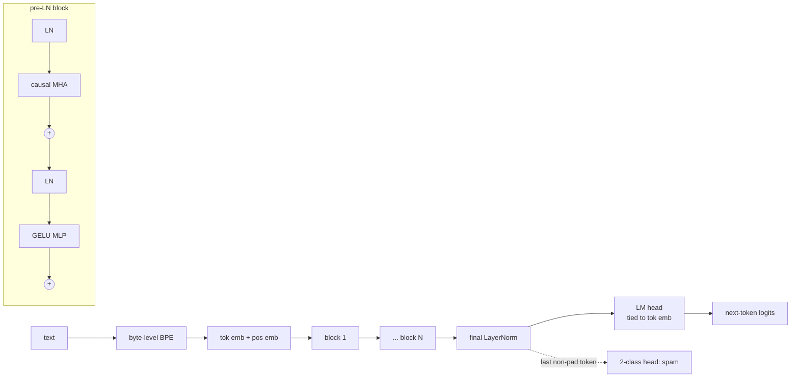
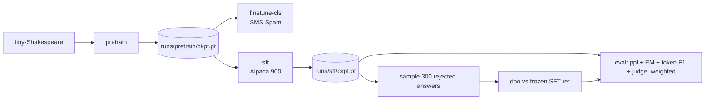

# minigpt — GPT from scratch

A small GPT built step by step in PyTorch: a byte-level BPE tokenizer, the
transformer, pretraining, loading real GPT-2 weights, classifier fine-tuning, SFT
and DPO. Only `torch.nn` primitives are used (Linear, Embedding, LayerNorm). The
tokenizer, attention, training loop, loss masking and DPO loss are all written here.
Curriculum lessons 30–41 of *AI Engineering from Scratch*.

## Problem

Each stage of a modern LM pipeline is shown as a small, testable module:

| Stage | Module | What it shows |
|---|---|---|
| Tokenizer | `bpe.py` | byte-level BPE trainer/encoder/decoder, GPT-2 pre-tokenisation regex, JSON save/load, special tokens |
| Data | `data.py` | sliding-window `(x, y)` next-token dataset |
| Model | `model.py` | token + learned position embeddings, own causal MHA (optional `F.scaled_dot_product_attention`), pre-LN blocks, GELU MLP, weight-tied head, `generate(temperature, top_k)` |
| Training | `train.py` | AdamW (decay on 2-D weights only), linear warmup + cosine LR, clip 1.0, periodic eval, best-val checkpoint, device mps → cuda → cpu |
| Pretrained | `pretrained.py` | HF GPT-2 124M safetensors → `GPTConfig(50257, 1024, 768, 12, 12)`, Conv1D transposes |
| Classifier | `finetune_cls.py` | head swap to 2 classes; train last block + final LN + head on UCI SMS Spam (balanced, 70/10/20) |
| SFT | `sft.py` | Alpaca prompt template, prompt tokens masked with `-100` |
| DPO | `dpo.py` | DPO loss (β = 0.1) against a frozen reference; pairs = dataset answer (chosen) vs SFT sample (rejected) |
| Eval | `evaluate.py` | perplexity, exact match, token F1, `Judge` protocol with an offline `MockJudge` (1-5), weighted `EvalReport` |

## Architecture





## Quickstart

Run from the repo root. Downloads go to `data/raw/`, outputs to `runs/` (both gitignored).

```bash
uv run minigpt train-tokenizer                     # BPE, vocab 1024, on tiny-Shakespeare
uv run minigpt pretrain --data tinyshakespeare --steps 2000   # random-offset windows; --sampling aligned = old recipe
uv run minigpt pretrain-eval                       # val-half and test-half loss of runs/pretrain/ckpt.pt
uv run minigpt generate --prompt "ROMEO:"
uv run minigpt data spam && uv run minigpt finetune-cls
uv run minigpt data alpaca && uv run minigpt sft
uv run minigpt dpo
uv run minigpt eval
uv run minigpt eval --n 100 --paired-vs sft --checkpoints sft=runs/sft/ckpt.pt,dpo=runs/dpo/ckpt.pt
```

Tests: `uv run pytest -q`. The GPT-2 parity test
needs internet and the extras:
`uv run --extra hf --extra test pytest -m network`.

## Results

All numbers come from one run on an Apple-silicon Mac (`device=mps`), seed 0, with the
CLI defaults. The model is 6 layers, d=256, 8 heads, context 256, 5.07M params, BPE vocab 1024.

All checkpoints were retrained from scratch after the repo split: pretrain, SFT and the spam classifier reproduce the earlier numbers exactly; DPO's epoch-2 loss and reward accuracy differ slightly (0.2427 / 0.940 vs 0.2314 / 0.95 before), cause not identified (same-seed reruns reproduce every metric and greedy response, but their weights differ by about 1e-5, so the cause may be run-to-run floating-point noise on MPS).

| Experiment | Metric | Result |
|---|---|---|
| BPE on tiny-Shakespeare | vocab / compression | 1024 tokens, 2.41 bytes/token (17 s to train) |
| Pretrain, 2000 steps (about 6 min), aligned windows | test loss / perplexity of the val-selected checkpoint (step 800), 3 seeds | **3.875 / 48.2** (seeds 3.872 to 3.879); the earlier selection-biased "val 3.648 / ppl 40.27" is superseded |
| Pretrain, random-offset windows (new default) | same, 3 seeds | **3.767 / 43.2** (Δ −0.109, per-seed CIs exclude 0), see [overfitting section](#pretraining-overfitting-and-a-selection-biased-headline) |
| SMS Spam, head swap (790,786 trainable params) | test accuracy / F1 (n=300) | **0.940** / 0.939 (precision 0.965, recall 0.914) |
| SFT, Alpaca 900 rows × 3 epochs | train loss | 4.286 → 3.453 |
| DPO, 300 pairs, β=0.1, 2 epochs | loss at step 1 / epoch 2 mean | 0.6931 (= log 2) / 0.2427; reward accuracy 0.940 |
| GPT-2 124M parity (network test) | greedy 10 tokens vs HF `transformers` | identical (test passes) |
| Unit tests | `pytest` | 90 passed, 1 deselected (network) in 15 s |

### Evaluation pipeline (course lesson 41)

`minigpt eval` runs four evals on every checkpoint and combines them into one weighted score:

- **Perplexity** on the held-out Alpaca responses (prompt tokens masked), mapped to [0, 1] as `1 − ln(ppl) / ln(vocab)` (1 = perfect, 0 = uniform guessing). Shakespeare perplexity is printed alongside but not aggregated.
- **Exact match** (SQuAD normalisation) on held-out Alpaca rows whose reference has ≤ 5 words (12 rows).
- **Token F1** on the first 50 held-out Alpaca rows by default; `--n 100` scores all 100 held-out rows.
- **Mock judge** (1–5) on the same rows. `MockJudge` maps ROUGE-L F1 onto the rubric. It fills the `Judge` protocol slot offline; it is not a quality judgement and duplicates token F1 (both measure lexical overlap), so it is printed but **not aggregated** by default.

The aggregate is the unweighted mean of perplexity score, EM and token F1 (`--w-ppl --w-em --w-f1` default 1, `--w-judge` default 0). `minigpt eval --checkpoints pretrain=runs/pretrain/ckpt.pt,sft=...`. Add `--paired-vs sft` for a paired bootstrap CI of each other checkpoint's per-row token F1 minus SFT (95% percentile CI, 10,000 row resamples, bootstrap p Holm-adjusted across the compared checkpoints) and `--rows-out PATH` to save per-row F1 and responses:

| Model | Alpaca ppl (held-out) | Shakespeare ppl | EM (n=12) | Token F1 (n=50) | Mock judge (ROUGE-L, 1-5) | Aggregate |
|---|---|---|---|---|---|---|
| pretrain | 409.23 | 40.27 (full validation split, on which this checkpoint was selected; test half: 48.20) | 0.000 | 0.048 | 1.00 | 0.060 |
| sft | 39.45 | 93.31 | 0.000 | 0.057 | 1.10 | 0.176 |
| dpo β=0.05 | 41.46 | 90.12 | 0.000 | 0.035 | 1.04 | 0.166 |
| dpo β=0.1 | 40.81 | 89.33 | 0.000 | 0.054 | 1.08 | 0.173 |
| dpo β=0.5 | 39.33 | 88.60 | 0.000 | 0.058 | 1.14 | 0.176 |

Reading, as measured:
- SFT cuts held-out Alpaca perplexity tenfold (409 → 39) and doubles Shakespeare perplexity (40 → 93): it learns the instruction format and forgets the pretraining domain. Almost all of the aggregate gain comes from this perplexity term.
- A 5M-parameter model trained on 900 instructions gets no exact match and near-floor F1; the generation metrics barely separate the checkpoints.
- An earlier version of this table measured perplexity on Shakespeare only, which ranked pretrain first. That compared the models on a domain SFT is meant to leave, so it was replaced.

Pretrain log (excerpt; seed 0, `--sampling aligned --dropout 0.1`, the recipe that produced `runs/pretrain/ckpt.pt`; val = first half of the held-out 10%):

```text
device=mps train_tokens=414,007 val_tokens=23,000 test_tokens=23,001
params=5,066,752
step     0 train 6.9923 val 6.9426 lr 1.00e-05
step   400 train 3.5398 val 3.7873 lr 9.46e-04
step   800 train 2.9612 val 3.5264 lr 7.31e-04
step  1200 train 2.3985 val 3.6315 lr 4.40e-04
step  1999 train 1.8529 val 3.9659 lr 1.00e-04
val loss step0=6.9964 best=3.5264 drop=49.6%
val-selected checkpoint (step 800): val loss=3.5264 ppl=34.00 (n=89 windows)  test loss=3.8754 ppl=48.20 (n=89 windows)
```

`minigpt generate --prompt "ROMEO:"`:

```text
ROMEO:
It's name, my wilt bend?

ROMEO:
Ay, the dead; and I would thou wilt swear,
I fear thy sound not that thou shouldst wilt say it thee.

ROMEO:
Then, sin me, thou art a man that thou art a torment,
To have thee in thee to death; let
```

SFT sample on a held-out instruction (greedy):

```text
### Instruction: Calculate the cost of 4 apples at $2.50 each.
### Model: The calcon is 1000.
### Reference: The cost of 4 apples at $2.50 each is $10.00.
```

How to read these results:
- **Overfitting.** About 414k training tokens is small for 5M params. Val loss bottoms out at step 800 and rises after that while train loss keeps falling. The checkpoint keeps the best-val weights, so every downstream stage starts from step 800 of the aligned-window run. Random-offset windows reduce but do not remove this (see the pretraining section below).
- **SFT.** The model learns the response *format*: short declarative answers that reuse words from the instruction. It cannot learn facts or arithmetic, because it was pretrained only on Shakespeare.
- **DPO.** It learns the preference: reward accuracy rises with β and the loss always starts at exactly log 2. Held-out quality does not move detectably. All runs train on the **same 300 preference pairs** (sampled once, saved to `runs/dpo/pairs.json`, reused via `--pairs-file`), so only β or the seed differs:

  | Checkpoint | DPO loss (epoch 2) | Reward acc. | Token F1 (n=50) | Mock judge (1-5) |
  |---|---|---|---|---|
  | sft | – | – | 0.057 | 1.10 |
  | β=0.05, seed 0 | 0.386 | 0.923 | 0.035 | 1.04 |
  | β=0.1, seed 0 | 0.243 | 0.940 | 0.054 | 1.08 |
  | β=0.1, seed 1 | 0.243 | 0.940 | 0.048 | 1.10 |
  | β=0.1, seed 2 | 0.236 | 0.940 | 0.042 | 1.02 |
  | β=0.5, seed 0 | 0.051 | 0.977 | 0.058 | 1.14 |

  **Paired test on all 100 held-out rows.** The n=50 point values above carry no uncertainty, so every existing DPO checkpoint was re-scored on all 100 held-out rows (greedy, 60 new tokens) and compared with SFT by a paired bootstrap on per-row token F1 (10,000 row resamples, seed 0). The rule was fixed before scoring ([`docs/protocol-dpo-paired-bootstrap.md`](docs/protocol-dpo-paired-bootstrap.md)): a variant is **different** from SFT only if its 95% CI excludes 0 **and** its Holm-adjusted p (Holm over all 10 existing DPO checkpoints) is below 0.05; otherwise it is **no detectable difference**. SFT token F1 on the 100 rows is 0.069 (0.057 on the first 50).

  | Checkpoint | F1 (n=100) | F1 (first 50) | Δ F1 vs SFT | 95% CI | p | p (Holm) | Verdict |
  |---|---|---|---|---|---|---|---|
  | β=0.05, seed 0 | 0.054 | 0.035 | -0.0150 | [-0.0292, -0.0010] | 0.0364 | 0.364 | no detectable difference |
  | β=0.1, seed 0 | 0.068 | 0.054 | -0.0013 | [-0.0156, +0.0133] | 0.8685 | 1.000 | no detectable difference |
  | β=0.1, seed 1 | 0.063 | 0.048 | -0.0060 | [-0.0197, +0.0075] | 0.3916 | 1.000 | no detectable difference |
  | β=0.1, seed 2 | 0.055 | 0.042 | -0.0139 | [-0.0283, +0.0004] | 0.0550 | 0.440 | no detectable difference |
  | β=0.5, seed 0 | 0.065 | 0.058 | -0.0037 | [-0.0146, +0.0068] | 0.4896 | 1.000 | no detectable difference |

  Ten checkpoints were scored (`runs/dpo`, `runs/dpo_b*`, `runs/fx_*`), but they are five distinct models: β=0.1 seed 0 exists four times (`dpo`, `dpo_b0.1`, `fx_b0.1_a`, `fx_b0.1_b`), β=0.05 and β=0.5 twice each (`dpo_b*`, `fx_b*_a`). Same-seed reruns differ in weights by about 1e-5 (so the pre-registration's "none bit-identical, none merged" check passed), yet every one of the 100 greedy responses is identical within each group, so each group gives one row above and the same CI. The Holm adjustment was applied over the 10 pre-registered rows, as written. Merging the duplicates (**post-hoc**, 5 comparisons) gives Holm p of 0.182 (β=0.05), 0.220 (β=0.1 seed 2) and 1.0 for the rest, so the verdicts do not change.

  No variant is different from SFT, and every point estimate is below SFT. "No β improves on SFT" holds, but with 100 rows the CIs are about ±0.014 F1 wide, so a small gain or loss is not excluded: β=0.05 has a raw 95% CI that excludes 0 on the negative side (and β=0.1 seed 2 only just includes it), which does not survive Holm over 10 comparisons. The rows are the only source of uncertainty here: the 300 pairs and each seed's training are fixed, so the CIs do not cover variation across training seeds or pair samples (the seed spread above is a separate, rough look at that). The rejected samples come from the same weak model, so DPO mostly learns to move away from its own outputs: it optimises likelihood margins, not answer quality. Reported as measured.

### Pretraining: overfitting and a selection-biased headline

The earlier headline (val loss 3.648, perplexity 40.27) picked the best of 11 validation evaluations and reported that same minimum, so it is optimistically biased. The model also overfits: the train set is 414k tokens in non-overlapping windows (about 40 epochs in 2000 steps) and val loss turns up after step 800. The held-out 10% is now cut deterministically into contiguous **val** (first 23,000 tokens, selects the checkpoint) and **test** (last 23,001 tokens, reported only). Protocol, written before any run: [`docs/protocol-pretrain-regularization.md`](docs/protocol-pretrain-regularization.md). Raw per-run JSON and `summary.json`: `docs/pretrain-regularization/`. Reproduce with `minigpt pretrain --name pre_<variant>_s<seed> --seed <seed> [--sampling aligned] [--dropout 0.2] --results-out ...` and `minigpt pretrain-compare`.

Headline, corrected: the val-selected baseline checkpoint has **test loss 3.875 (perplexity 48.2)**, mean over seeds 0, 1, 2 (range 3.872 to 3.879). The seed-0 rerun reproduces the checkpoint used downstream: same selected step (800) and the existing `runs/pretrain/ckpt.pt` scores the same on both halves under `minigpt pretrain-eval` (val 3.5264, test 3.8754). So 3.648 / 40.27 understated the loss by about 0.23 nats; the halves differ in difficulty (val 3.53 vs test 3.88), so part of that gap is the split and not only selection.

Three variants, seeds 0, 1, 2, same 2000-step budget, one factor changed at a time, selected on val, scored on test. `base`: aligned windows, dropout 0.1. `randoff`: random-offset windows (stride-1 windows, shuffled). `drop02`: aligned, dropout 0.2. Δ is test loss minus the same-seed baseline; the CI is a paired bootstrap over the 89 test windows (10,000 resamples), so it reflects test-set sampling noise only.

| Variant | seed | selected step | test loss (ppl) | Δ test vs base [95% CI] |
|---|---|---|---|---|
| base | 0 / 1 / 2 | 800 / 800 / 800 | 3.8754 (48.20) / 3.8785 (48.35) / 3.8720 (48.04) | n/a |
| drop02 | 0 | 1200 | 3.8282 (45.98) | −0.047 [−0.064, −0.030] |
| drop02 | 1 | 1400 | 3.8539 (47.17) | −0.025 [−0.041, −0.008] |
| drop02 | 2 | 1200 | 3.8408 (46.56) | −0.031 [−0.047, −0.016] |
| randoff | 0 | 1200 | 3.7408 (42.13) | −0.135 [−0.153, −0.116] |
| randoff | 1 | 1400 | 3.7646 (43.14) | −0.114 [−0.135, −0.093] |
| randoff | 2 | 1200 | 3.7946 (44.46) | −0.077 [−0.101, −0.053] |

Pre-registered rule: adopt a variant only if, on every seed, its test loss is lower than the baseline by at least 0.05 **and** the per-seed 95% CI excludes 0. `randoff` meets it on all three seeds (mean test loss 3.767, Δ −0.109); `drop02` does not (its gain is 0.025 to 0.047 on every seed, below the 0.05 margin). **Decision: random-offset sampling is the new default; dropout stays 0.1.** `--sampling aligned` restores the old windows. Neither variant removes the overfitting: val loss still rises after its minimum (`randoff` ends at val 3.41 to 3.42 vs minimum 3.35 to 3.37). The test half is 23k tokens of one contiguous passage adjacent to the validation half, so this is a within-corpus hold-out. The 0.05 margin and the choice of variants were fixed before the runs; nothing in this section is post-hoc.

The default change affects only new runs. SFT, DPO, the spam classifier and the eval tables in this README were trained from the old aligned-window checkpoint (`runs/pretrain/ckpt.pt`, not overwritten) and are **not retrained**; a bare `minigpt pretrain` no longer reproduces that checkpoint (use `--sampling aligned`).

## Design decisions

- **Byte-level BPE with GPT-2 regex pre-tokenisation.** Byte-level means no unknown tokens and lossless round-trips (tested on CJK and emoji). The regex stops merges from crossing word and punctuation boundaries. When two pairs have the same count, the smallest pair id wins, so training is deterministic. Encoding memoises each chunk, so encoding the 1.1 MB corpus takes seconds.
- **Own attention with an SDPA flag.** The explicit masked-softmax path is the reference implementation, and a test checks that it matches `F.scaled_dot_product_attention`. MPS's fused kernel has no dropout support, so in training on MPS the model falls back to the explicit path.
- **Weight tying.** The 124M config has exactly 124,439,808 parameters (tested on the `meta` device, so no memory is allocated). This matches GPT-2.
- **Checkpoints store `asdict(config)`, not a pickled dataclass.** This keeps them loadable with `torch.load`'s default `weights_only=True`.
- **The classifier reads the last *non-pad* token.** Causal attention means that position has seen the whole message and none of the padding. A test checks that extra padding does not change the logits.
- **DPO runs the policy with dropout off** (`eval()` mode, gradients still flow). Without this, dropout noise alone makes policy ≠ reference at step 0, and the first loss came out at 0.94 instead of log 2 in an earlier run.
- **No offline fake data.** Downloads raise an error on failure; they never fall back to fabricated samples. Default tests are fully offline. The HF parity test is marked `network` and `slow`.
- **CPU torch on Linux CI.** `[tool.uv.sources]` sends `torch` to the PyTorch CPU index on Linux only; macOS keeps the PyPI wheel, which includes MPS.
