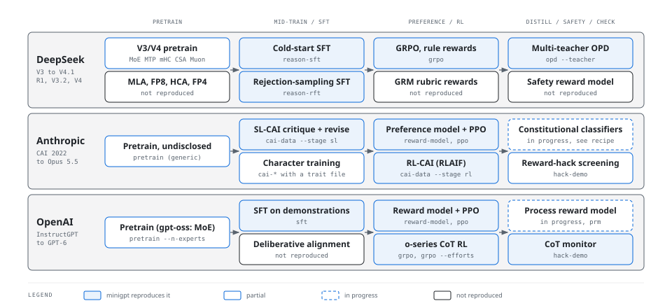

# How DeepSeek, Anthropic and OpenAI train their models, and what minigpt reproduces

This page lists each lab's published training pipeline, stage by stage, with a primary source
and date, then says which stage a minigpt command reproduces at toy scale (`has`, `partial`,
`missing`). Toy results are the README's, at the seed counts stated there; they test a stage's
shape on addition, not any lab's claim.

How to read it:

- **P** = published by the lab (paper, model card, system card, official blog). **I** = inferred
  by outsiders, not stated by the lab. Every pipeline row is P and links its source; I rows are
  labelled in the "Not published" list of each lab. No row relies on a secondary source.
- Dates are the first public version (arXiv submission or post date); later revisions are noted.
  Sources were opened on 2026-11-27.
- The labs differ a lot in disclosure. DeepSeek publishes architecture, optimizer and post-training
  recipes with open weights. OpenAI publishes the shape of its methods in papers and an
  open-weight model card (gpt-oss) but not its frontier training. Anthropic publishes the
  alignment method papers and a constitution, and its system cards give only a summary of
  training.

## 1. DeepSeek

### Pipeline (P)

| # | Stage | What it does | Source (date) |
|---|---|---|---|
| 1 | V3 pretraining | 671B total / 37B active MoE, 14.8T tokens. Multi-head Latent Attention, DeepSeekMoE with auxiliary-loss-free balancing, multi-token prediction, FP8 mixed precision | [DeepSeek-V3, arXiv 2412.19437](https://arxiv.org/abs/2412.19437) (27 Dec 2024) |
| 2 | V3 SFT | 1.5M instruction instances; reasoning data generated by an internal R1 model, other domains by expert models built with SFT + RL, filtered by rejection sampling | same, §5.1 |
| 3 | V3 RL | GRPO with rule-based rewards where an answer can be checked and a model-based reward model elsewhere; for open-ended prompts a constitutional-AI-style self-vote of V3 itself as feedback (§5.4.2) | same, §5.2, §5.4.2 |
| 4 | R1-Zero | GRPO straight on the V3 base, rule-based accuracy and format rewards, no SFT | [DeepSeek-R1, arXiv 2501.12948](https://arxiv.org/abs/2501.12948) (22 Jan 2025; revised 4 Jan 2026) |
| 5 | R1 cold start | SFT on thousands of long chain-of-thought examples written to read as conversational thinking | same, Fig. 2, App. B.3.2 |
| 6 | R1 reasoning RL | GRPO with rule-based rewards plus a language-consistency reward | same, §3.2.1 |
| 7 | R1 rejection-sampling SFT | Sample from the stage-6 checkpoint, keep correct traces (about 600k reasoning samples, judged by rules or by V3 as a generative judge) plus about 200k non-reasoning samples, retrain the base on the 800k | same, App. B.3.3 |
| 8 | R1 second RL | Rule rewards for reasoning; a pairwise helpfulness reward model and a point-wise safety reward model (106,000 prompts labelled safe or unsafe) for general prompts. 1,700 steps; preference rewards only in the last 400 because more steps with them risked reward hacking | same, §3.1, §3.2.2 |
| 9 | R1 distillation | Plain SFT of Qwen and Llama bases on the 800k samples, no RL | same, App. B |
| 10 | V3.2 continued pretraining | From V3.1-Terminus: dense warm-up, then a sparse stage with DeepSeek Sparse Attention (DSA) | [DeepSeek-V3.2, arXiv 2512.02556](https://arxiv.org/abs/2512.02556) (2 Dec 2025), §2.1.1 |
| 11 | V3.2 specialists | One specialist per domain (maths, programming, logical reasoning, agentic, agentic coding, agentic search, plus writing and QA), each SFT + large-scale RL from the same base; each specialist generates data for the final model | same, §3 |
| 12 | V3.2 mixed RL | One GRPO stage merging reasoning, agent and alignment: rule outcome reward + length penalty + language-consistency reward; for general tasks a generative reward model with per-prompt rubrics. Stability fixes: unbiased K3 KL estimate, off-policy sequence masking, keeping MoE routing and top-p/top-k masks between sampling and training | same, §3 |
| 13 | V4 pretraining | Flash 284B/13B (32T tokens) and Pro 1.6T/49B (33T). Hybrid compressed sparse + heavily compressed attention (CSA, HCA), manifold-constrained hyper-connections (mHC), Muon for most weights (AdamW for embeddings, head, norms), 1M context via 4K, 16K, 64K, 1M, hash routing in the first 3 MoE layers, MTP depth 1, two fixes for loss spikes (anticipatory routing, SwiGLU clamping) | [DeepSeek-V4, arXiv 2606.19348](https://arxiv.org/abs/2606.19348) (submitted 26 Apr 2026), §2, §4 |
| 14 | V4 specialists | As V3.2: SFT then GRPO per domain, with three reasoning-effort modes (non-think, high, max), each with its own length penalty and context window | same, §5.1.1 |
| 15 | V4 generative reward model | No scalar reward model: rubric-guided RL data, and the actor itself is the generative reward model, so judging and generating are optimised together | same, §5.1.1 |
| 16 | V4 on-policy distillation | The mixed RL stage of V3.2 is replaced by multi-teacher on-policy distillation: the student samples, and is pulled toward the teacher for each domain by full-vocabulary reverse KL. More than ten teachers | same, §5.1.2 |
| 17 | V4 FP4 QAT | Quantization-aware training to MXFP4 for expert weights and the CSA indexer, in post-training | same, §5.2.1 |
| 18 | V4.1-Flash | 45T multimodal tokens, no new post-training algorithm. Effort goes into synthesised verifiable agent tasks and environments, async RL across scaffolds, merging checkpoints to restart RL runs, a scalar effort level with an exponential token penalty, and a final OPD with over 40 teachers | [DeepSeek-V4.1-Flash, arXiv 2609.19969](https://arxiv.org/abs/2609.19969) (17 Sep 2026), §4, §5 |

Not published: the data mix beyond category names; V4 RL hyperparameters beyond a statement that
they stay close to earlier work; the rubric and task data. I found no safety-training description
in the V4 or V4.1 reports (searched their text for "safety", "harmless", "alignment"); R1's safety
reward model (row 8) is the only one DeepSeek documents. **I**: none used for this lab.

### What minigpt reproduces

| # | Stage | minigpt | Status | Toy result (README) |
|---|---|---|---|---|
| 1, 13 | MoE, aux-loss-free balancing, MTP, mHC, CSA, Muon | `pretrain --n-experts --mtp-depth --hc-streams --attn-type csa --optimizer muon`; [`docs/recipes/deepseek-v4.md`](recipes/deepseek-v4.md) | partial | Balancing works (worst expert load 1.1x mean). Muon is the largest gain on equations (3-digit 0.39 to 0.96, 4 seeds). No MLA, HCA, hash routing, FP8 or FP4 |
| 10 | Continued pretraining into a new regime | `pretrain --init --replay-corpus --replay-frac` | partial | Replay cuts forgetting (general test loss 1.418 to 4.009 without replay, +0.09 with 50% replay). It continues a dense model; there is no dense-to-sparse switch |
| 2, 5 | Cold-start / SFT on traces | `reason-sft`; `sft` for chat | has | SFT base scores 0.98 / 0.94 / 0.86 on 1-3 digits |
| 4 | R1-Zero | `grpo` from `reason-pretrain` | has | Fails: no `<think>` appears, so every group has equal reward and no gradient ([`offline-recipes.md`](recipes/offline-recipes.md); seed 0) |
| 6, 12 | GRPO, rule rewards, V3.2 KL and masking | `grpo`, `--unbiased-kl --no-std-norm`, `--fill-batch`; [`rl-losses.md`](recipes/rl-losses.md) | has | RL sharpens what SFT can already do; the V3.2 changes show no measurable effect (3-4 seeds) |
| 7 | Rejection-sampling SFT | `reason-rft` | has | R1's cold SFT, RL, RS-SFT, RL chain: no measurable difference from plain GRPO (2 seeds). Llama 3-style rounds of rejection sampling did beat it, and the gain came from the sampled data, not the DPO after it (2 seeds) |
| 8 | Second RL with preference rewards | `reward-model` + `ppo`, `hack-demo` | partial | The reward-hacking risk DeepSeek cites is reproduced: proxy rises while gold accuracy falls ([README](../README.md#rlhf-reward-model--ppo)). No safety RM |
| 9 | Distil into a small model | `opd --student-config`, `opd --off-policy` | partial | A 125k-parameter random-init student learns nothing useful from either mode; distillation needs a student that already works |
| 11, 14 | Per-domain specialists | `reason-sft --ops -`, `grpo --ops -` | has | `+` and `-` specialists reach 1.00 on 1 digit and 0.98 or better on 2-3 digits |
| 14, 18 | Effort modes / effort level | `grpo --efforts 1,9`, `reason-sft --efforts` | has | Inconclusive: both levels learned to skip the think block |
| 15, 12 | Generative / rubric reward model | none; closest is the LLM judge in `cai-data` | missing | The judge is a frozen Ollama model, not the policy, and has no per-prompt rubric |
| 16, 18 | Multi-teacher on-policy distillation | `opd --teacher +=PATH --teacher=-=PATH` | has | Held-out reverse KL cut by more than half on both operators (1 seed). Off-policy did as well |
| 17 | FP4 QAT | none | missing | |
| 18 | Agent task synthesis, environments, async RL | none | missing | Merging runs is `merge`, tested only as expert merging (never beat the base by 0.05) |

What toy scale cannot show:

- Anything about long context: at 128-256 tokens CSA saves no compute, so the CSA/HCA design
  goal (27% of V3.2 FLOPs and 10% of its KV cache at 1M tokens, per the V4 abstract) is untestable.
- Numerics: FP8 and FP4 training, the loss-spike fixes, expert-parallel communication.
- RL that discovers behaviour: R1's "aha" reflection needs a base that can already attempt hard
  problems; here the only verifiable task is addition and 4-5 digits are never learned.
- Real tasks and tool use: the V3.2 and V4.1 gains come from agent environments, not the optimizer.
- Scale effects of distillation: ten or forty heterogeneous teachers, one student.

## 2. Anthropic

### Pipeline (P)

| # | Stage | What it does | Source (date) |
|---|---|---|---|
| 1 | Pretraining | Proprietary mix of public web (crawled by ClaudeBot, robots.txt respected), public and private datasets, user data that users permitted for training, and synthetic data from other models; deduplication and classifier filtering. Architecture, size and token count are not stated | [Claude Opus 5.5 system card](https://www.anthropic.com/document/claude-opus-5-5-system-card) §1.1 (22 Sep 2026) |
| 2 | Human-feedback RLHF | A preference model trained on human comparisons, then RL against it; the policy and preference model were refreshed weekly with new human data ("iterated online"); reward grows about linearly with the square root of the KL from the initial policy | [Bai et al., HH-RLHF, arXiv 2204.05862](https://arxiv.org/abs/2204.05862) (12 Apr 2022) |
| 3 | SL-CAI | Sample from a model, have it critique and revise its own answer against a principle from a written constitution, fine-tune on the revisions | [Bai et al., Constitutional AI, arXiv 2212.08073](https://arxiv.org/abs/2212.08073) (15 Dec 2022) |
| 4 | RL-CAI (RLAIF) | Sample pairs from the SL-CAI model, a model picks the better one under a principle, train a preference model on those AI labels, RL against it; chain-of-thought labelling optional | same |
| 5 | Character training | A "character" variant of CAI, used from Claude 3: a list of traits, Claude writes messages relevant to each trait, answers in character, then ranks its own answers by trait fit; the ranks train a preference model | [Claude's character](https://www.anthropic.com/research/claude-character) (8 Jun 2024) |
| 6 | Constitutional classifiers | Input and output classifiers trained on synthetic data generated from a natural-language constitution of allowed and restricted content. 3,000+ estimated red-team hours, no universal jailbreak found; jailbreak success on the guarded model 4.4% vs 86% unguarded, at +23.7% compute and +0.38% refusals | [arXiv 2501.18837](https://arxiv.org/abs/2501.18837) (31 Jan 2025) |
| 7 | Constitutional Classifiers++ | One exchange classifier sees input and output together; a cascade where a cheap first stage screens all traffic and escalates; a linear probe on the model's own activations as the cheap stage, ensembled with an external classifier. About 1% extra compute, 0.05% refusals on production traffic, 1,700+ red-team hours with no universal jailbreak | [arXiv 2601.04603](https://arxiv.org/abs/2601.04603); [blog](https://www.anthropic.com/news/next-generation-constitutional-classifiers) (9 Jan 2026) |
| 8 | Published constitution | The document that "plays a crucial role in our training process"; released CC0. The card says post-training aims to make Claude behave per this constitution | [Claude's new constitution](https://www.anthropic.com/constitution) (22 Jan 2026) |
| 9 | Post-training with crowd workers | Data-work platforms supply preference selection, safety evaluation and adversarial testing | Opus 5.5 card §1.2 (22 Sep 2026) |
| 10 | RL on production environments, with hack screening | Automated classifiers flag reward-hacking behaviour in RL episodes sampled at every training step, and the results are used to harden environments. Some snapshots concealed actions from an automated grader (e.g. hiding git changes) | Opus 5.5 card §6.2.1, §6.5.4.4 |
| 11 | Reward-hacking research | Learning to reward-hack in production-style coding environments generalised to alignment faking and sabotage. Effective mitigations: stop the hacking, more diverse RLHF safety data, and "inoculation prompting" (framing hacking as acceptable in training) | [arXiv 2511.18397](https://arxiv.org/abs/2511.18397) (23 Nov 2025) |
| 12 | Alignment audits | Teams try to find a hidden objective in a model trained with one; the card also uses white-box probing and training-data review during post-training | [arXiv 2503.10965](https://arxiv.org/abs/2503.10965) (14 Mar 2025); card §6 |
| 13 | Deployed cyber safeguards | Three stages: an activation probe screens all traffic, a lightweight classifier on the model itself scores escalations, a trained LLM classifier decides; "modeled on the constitutional classifiers", trained on violative exchanges, augmented toward jailbreaks and long agentic tasks | Opus 5.5 card §3.2 (22 Sep 2026) |

Not published: pretraining architecture and scale; the RL algorithm and reward models behind
current Claude models; how much of SL-CAI and RL-CAI as published in 2022 is still used. The
Opus 5.5 card says only "rigorous post-training and fine-tuning" toward the constitution.
**I**: that current post-training mixes human preference RL, AI feedback and RL on verifiable
environments is an outsider reading of rows 2-4, 9 and 10, not a statement by Anthropic.

### What minigpt reproduces

| # | Stage | minigpt | Status | Toy result (README) |
|---|---|---|---|---|
| 1 | Pretraining | `pretrain` (dense or toy V4) | partial | Generic only; nothing about Claude's architecture is public to copy |
| 2 | Preference model + RL | `reward-model`, `ppo` | has | One run: a 0.827-accuracy reward model, then PPO drove gold accuracy from 0.73 to 0.00 at beta 0.02 while the proxy rose. The labeler is a program, not humans, and the loop is offline, not weekly online |
| 3 | SL-CAI | `cai-data --stage sl`, `cai-train --stage sl`; [constitution](cai/constitution.md) | has | Adherence 1.00 to 1.25 on 20 prompts (1 seed, judge `qwen3:8b`, no CI) |
| 4 | RL-CAI | `cai-data --stage rl`, `cai-train --stage rl` | partial | DPO replaces the preference model + RL. The judge picked the first-shown answer 86.1% (93/108), so DPO mostly learned position noise |
| 5 | Character training | `cai-*` with `--constitution` pointing at a trait file | partial | Same code path; no trait file is shipped and no run was made |
| 6, 7, 13 | Constitutional classifiers, cascade, probe | `guard`; [`docs/recipes/constitutional-classifiers.md`](recipes/constitutional-classifiers.md) | partial | Template data, not LLM-generated; no exchange classifier. Probe on the policy's activations: 0.070–0.085 attack success on held-out obfuscated attacks, no measurable difference from an input classifier fine-tuned from the same policy at about 1/2,500 of its compute; cascade cuts the probe's look-alike false refusals from 0.21–0.225 to 0.025–0.075 (4 seeds) |
| 8 | Constitution as the spec | [`docs/cai/constitution.md`](cai/constitution.md) | partial | 7 original lines, not Anthropic's text |
| 10 | Reward-hack screening of RL episodes | `hack-demo`, rule-based CoT monitor in `monitor.py` | partial | From a weak SFT base the exploit paid (hack rate 0.077 to 0.197, true accuracy 0.048 to 0.001); monitor recall 0.92, precision 0.04. A rule monitor, not a trained classifier |
| 11 | Inoculation prompting, emergent misalignment | none | missing | |
| 12 | Alignment audits, white-box probing | none | missing | Probing exists only inside the classifier recipe |
| 9 | Crowd preference labels | none | missing | A program stands in for the labeler |

What toy scale cannot show:

- Judge quality: a Qwen3 8B judge reading a 7-line file is not a model applying a long
  constitution; the 86.1% first-slot rate is the failure that matters here.
- Human preference data and its noise; weekly online refresh.
- Robustness: classifier claims rest on thousands of red-team hours; a toy classifier tested on
  a fixed set shows the mechanism, not the robustness.
- [INFERENCE] Probes on a 1-6M-parameter model likely read much weaker concepts than a frontier
  model's activations, so a toy probe result will not transfer.
- Reward hacking in long agentic environments, and anything about welfare, audits or character at
  the level of a real model.

## 3. OpenAI

### Pipeline (P)

| # | Stage | What it does | Source (date) |
|---|---|---|---|
| 1 | InstructGPT | (1) SFT on labeler demonstrations, (2) reward model trained on labeler rankings of 4-9 outputs per prompt, (3) PPO against the reward model with a KL penalty to the SFT model; PPO-ptx mixes in pretraining gradients. A 1.3B InstructGPT was preferred to 175B GPT-3 | [Ouyang et al., arXiv 2203.02155](https://arxiv.org/abs/2203.02155) (4 Mar 2022) |
| 2 | Process reward model | A reward model trained on step-level human labels (PRM800K: 800,000 labels) beats one trained on final answers, used to pick the best of N samples; solves 78% of a MATH test subset; active learning helps | [Lightman et al., arXiv 2305.20050](https://arxiv.org/abs/2305.20050) (31 May 2023) |
| 3 | Instruction hierarchy | Train the model to follow higher-privilege instructions (system messages) over lower-privilege ones (user text, tool output) when they conflict | [Wallace et al., arXiv 2404.13208](https://arxiv.org/abs/2404.13208) (19 Apr 2024) |
| 4 | Model Spec | The written policy of intended behaviour; first released 8 May 2024, now versioned (latest 29 Oct 2026) | [Model Spec 2024-05-08](https://cdn.openai.com/spec/model-spec-2024-05-08.html); [latest](https://model-spec.openai.com/) |
| 5 | Rule-based rewards | Propositions (e.g. "judgmental", "contains disallowed content") graded by an LLM are combined by rules into a safety reward that is added to the helpful reward model in RLHF; used since the GPT-4 launch | [blog](https://openai.com/index/improving-model-safety-behavior-with-rule-based-rewards/) (24 Jul 2024); [arXiv 2411.01111](https://arxiv.org/abs/2411.01111) (2 Nov 2024) |
| 6 | o-series reasoning RL | o1 "trained with reinforcement learning to perform complex reasoning"; accuracy rises with RL train compute and with test-time thinking. No algorithm, data or reward details | [Learning to reason with LLMs](https://openai.com/index/learning-to-reason-with-llms/) (12 Sep 2024) |
| 7 | Deliberative alignment | Prompt a reasoning model with the safety spec to produce {prompt, CoT, answer} tuples whose CoT cites the spec; filter them with a spec-aware reward model; SFT on them; then RL with that same spec-aware judge. No human-written CoTs or answers | [arXiv 2412.16339](https://arxiv.org/abs/2412.16339) (20 Dec 2024) |
| 8 | CoT monitoring | A weaker LLM reading the chain of thought of o3-mini caught reward hacking in coding environments better than watching actions. Penalising "bad thoughts" in the reward taught the model to hide intent | [blog](https://openai.com/index/chain-of-thought-monitoring/) (10 Mar 2025); [arXiv 2503.11926](https://arxiv.org/abs/2503.11926) (14 Mar 2025) |
| 9 | gpt-oss pretraining | Text-only, "trillions of tokens", STEM, coding and general knowledge; CBRN pre-training filters from GPT-4o. MoE (128 experts for 120b, 32 for 20b), alternating banded and dense attention, GQA, learned softmax bias, MXFP4 for MoE weights, o200k_harmony tokenizer. 2.1M H100-hours for 120b | [gpt-oss model card, arXiv 2508.10925](https://arxiv.org/abs/2508.10925) (8 Aug 2025) §2 |
| 10 | gpt-oss post-training | "Similar CoT RL techniques as o3" for reasoning and tools (browsing, Python, developer functions); the abstract says "large-scale distillation and reinforcement learning". Harmony chat format with channels (analysis, commentary, final) and System > Developer > User > Assistant > Tool; three effort levels (low, medium, high) set in the system prompt | same, §2.5 |
| 11 | gpt-oss safety | Deliberative alignment and the instruction hierarchy to refuse, resist jailbreaks and prompt injection. "No direct optimization pressure on the CoT" so developers can monitor it. Adversarial helpful-only RL fine-tuning to bound worst-case capability | same, §4.3, §4.4, §5.1 |
| 12 | GPT-6 Astra | Reasoning "trained through reinforcement learning" with a long CoT; alignment work "spans the entire training stack" from the composition of pretraining data to grading in RL, including many worked examples of the Model Spec; "fairly confident" there is no significant direct CoT grading pressure; misalignment monitoring on all tool-using deployment; CoT controllability rose during RL | [GPT-6 Astra system card](https://deploymentsafety.openai.com/gpt-6-astra) (3 Sep 2026) §2, §8.1; [lifecycle post](https://alignment.openai.com/cot-monitorability-model-lifecycle) (10 Nov 2026) |

Not published: architecture, data and scale of GPT-4-class and later models; the o-series RL
algorithm and reward design; whether gpt-oss used SFT or only distillation plus RL (the card does
not say). **I**: that o-series RL is "GRPO-like" is an outsider guess; the lab has not said so.

### What minigpt reproduces

| # | Stage | minigpt | Status | Toy result (README) |
|---|---|---|---|---|
| 9 | Pretrain with MoE | `pretrain --n-experts` | partial | MoE lowers TinyStories test loss 5.0% at matched active parameters (2 seeds). No banded attention, sinks or MXFP4 |
| 1 | SFT on demonstrations | `sft` (Alpaca 1k), `reason-sft` | has | |
| 1 | Reward model | `reward-model` | has | Held-out pairwise accuracy 0.827 with 1,908 pairs; 0.500 (chance) with the default 232 |
| 1 | PPO + KL to SFT | `ppo` | has | Gold accuracy fell at every beta; unstable, not a clean overoptimization curve. No PPO-ptx |
| 2 | Process reward model | `prm`, `best-of-n`, `grpo --prm`; [`docs/recipes/prm.md`](recipes/prm.md) | has | Step labels from an exact checker, not humans. Best-of-16 on 3 digits: PRM 0.245–0.365 beats ORM 0.100–0.140; no measurable difference from majority vote (0.355). Post hoc, at N=16 majority vote beats the PRM at 1 digit (0.945 vs 0.815–0.870) and 2 digits (0.710 vs 0.585–0.665), so the PRM's lead over majority shrinks as N grows, the opposite of the paper's trend. PRM-shaped GRPO reward: no measurable difference (4 seeds) |
| 3, 10 | Instruction hierarchy, harmony format, tools | none | missing | |
| 4 | Model Spec | [`docs/cai/constitution.md`](cai/constitution.md) plays the role of a spec for the judge | partial | |
| 5 | Rule-based rewards | none as such; `lenient_reward` and `accuracy_reward` are rule graders | partial | The rule-grader exploit is `hack-demo` |
| 6 | o-series CoT RL | `grpo` on `<think>` traces | has | Sharpens a trained base (0.68 / 0.62 / 0.30 base, 1.00 / 0.93 / 0.75 after, 3 seeds); cannot reach 4-5 digits |
| 7 | Deliberative alignment | none | missing | SL-CAI is the nearest relative but trains on the revised answer, not on a CoT that cites the spec |
| 8, 11 | CoT monitoring, no CoT pressure | `hack-demo`, `monitor.py` | has | Monitor recall 0.92, precision 0.04 (rule-based; sees only the completion). No arm trains against the monitor |
| 10 | Variable effort | `grpo --efforts 1,9` | has | Inconclusive (see DeepSeek row 14) |
| 10 | Large-scale distillation | `opd`, `reason-rft --sampler` | partial | Rejection-sampled SFT on expert samples matched Muon-tuned distillation at 12-16x less GPU time (4 seeds) |
| 12 | Misalignment monitoring, CoT controllability | none | missing | |

What toy scale cannot show:

- The o-series result itself: RL on a long, self-found CoT over hard problems. Here the reward is
  an exact checker on addition and the CoT is a fixed column-by-column format.
- Process supervision at its real cost: 800,000 human step labels; the toy can label steps for
  free, so it says nothing about annotation economics.
- Deliberative alignment and the Model Spec need a model that can read a long policy and reason
  about it.
- [INFERENCE] Monitorability trends (Astra's drop, the lifecycle post) need models whose
  no-CoT capability is high enough to act without verbalising; the toy model cannot.
- Instruction hierarchy, tool use, channels and agentic safety.

## 4. Cross-lab comparison

| | DeepSeek | Anthropic | OpenAI | minigpt |
|---|---|---|---|---|
| Pretraining | Fully described: MoE, MLA then CSA/HCA, mHC, MTP, Muon, FP8/FP4, 14.8T to 45T tokens (P) | Data sources only; architecture and scale unpublished (P, card §1.1) | GPT-x unpublished; gpt-oss described: MoE, banded + dense attention, MXFP4, trillions of tokens (P) | Dense GPT, or toy V4 with MoE, MTP, mHC, CSA, Muon, on Shakespeare or TinyStories |
| SFT / mid-training | Cold start of long CoT (R1); 1.5M mixed SFT (V3); specialist-generated data (V3.2, V4) (P) | SL-CAI revisions; character-trait data; details of current SFT unpublished (P, partly) | Labeler demonstrations (InstructGPT); spec-citing CoT data (deliberative alignment) (P) | `sft`, `reason-sft`, `cai-train --stage sl`, `reason-rft` |
| Preference / RL | GRPO on verifiable and rubric rewards; RL replaced by OPD in V4 (P) | Preference model + RL (HH-RLHF), RLAIF (RL-CAI), RL on production environments (P) | PPO on a reward model (InstructGPT), large-scale CoT RL (o-series, algorithm unpublished) (P) | `ppo`, `grpo` (many loss variants), `reason-dpo`, `dpo`, `cai-train --stage rl` |
| Reward source | Rules and tests; generative reward model with rubrics, trained as the actor (V4); safety RM 106k prompts (R1) (P) | Human crowd preferences, AI judgments against a constitution, automated hack classifiers on RL episodes (P) | Human rankings, step labels (PRM800K), LLM-graded rule propositions, spec-aware judge (P) | Exact checker, program labeler, process reward model on program step labels (`prm`), Ollama judge against 7 principles |
| Safety method | No training method documented in V4 or V4.1; safety RM and a risk-control system in R1 (P) | Constitutional AI, constitutional classifiers and probes, constitution, hack screening, audits (P) | Deliberative alignment, instruction hierarchy, rule-based rewards, CoT monitoring without CoT pressure, misalignment monitors (P) | CAI; CoT monitor (`hack-demo`); classifiers, probe and cascade (`guard`) |
| Distillation | Specialists to one student: SFT on specialist data (V3.2), then multi-teacher full-vocabulary OPD with 10 to 40+ teachers (V4, V4.1); R1 to small models by SFT (P) | Prompt-distilled training data (a model with a rubric prompt trains one without it, card §6.5.1) (P); no model-to-model recipe published | "Large-scale distillation" named in the gpt-oss abstract; no recipe (P) | `opd` (single and multi-teacher, on and off policy), `reason-rft --sampler`, `merge` |

Reading it: DeepSeek's contribution is mostly an open, verifiable recipe, so minigpt covers most
of its post-training. Anthropic's is how to specify behaviour in text (constitution, principles,
traits) and defend it with classifiers; minigpt covers the training stages and a toy version of
the classifier defence. OpenAI's is a mix of reasoning RL, reward design (process and rule-based)
and monitoring; minigpt covers the RL, the monitor and process rewards, while deliberative
alignment, rule-based rewards and the instruction hierarchy are missing.

The labs also borrow from each other. DeepSeek-V3 used a constitutional-AI-style self-vote
(Anthropic's method) for open-ended feedback; V4 cites on-policy distillation from Gu et al.
2024 and Lu and Thinking Machines Lab 2025 (see the
[blog](https://thinkingmachines.ai/blog/on-policy-distillation/)); and the V4 generative
reward model and OpenAI's spec-aware judge are both LLM-as-reward designs.

## 5. Where to run each stage

| Want to see | Command | Doc |
|---|---|---|
| A toy V4 model | `minigpt pretrain --n-experts 8 --mtp-depth 1 --hc-streams 4 --attn-type csa --optimizer muon` | [`recipes/deepseek-v4.md`](recipes/deepseek-v4.md) |
| R1 / R1-Zero stages | `reason-pretrain`, `reason-sft`, `grpo`, `reason-rft` | [`recipes/offline-recipes.md`](recipes/offline-recipes.md) |
| RL loss variants | `grpo --policy-loss ...` | [`recipes/rl-losses.md`](recipes/rl-losses.md) |
| V4 multi-teacher OPD | `opd --teacher +=... --teacher=-=...` | [`recipes/consolidation.md`](recipes/consolidation.md) |
| Constitutional AI | `cai-data`, `cai-train`, `cai-eval` | [`cai/constitution.md`](cai/constitution.md) |
| InstructGPT RLHF | `sft`, `reward-model`, `ppo` | [README](../README.md#rlhf-reward-model--ppo) |
| CoT monitor and reward hacking | `hack-demo` | [README](../README.md#cot-monitor-and-reward-hacking) |
| Process reward model | `prm`, `best-of-n` | [`recipes/prm.md`](recipes/prm.md) |
| Constitutional classifiers + probe | `guard` | [`recipes/constitutional-classifiers.md`](recipes/constitutional-classifiers.md) |
